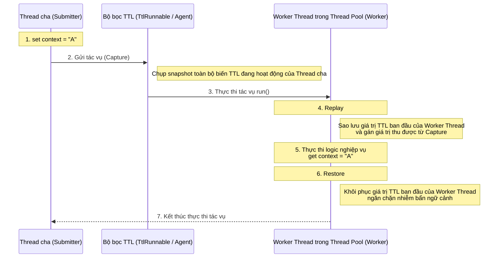

## ThreadLocal

### ThreadLocal dùng để làm gì?

Thông thường, các biến mà chúng ta tạo ra có thể được truy cập và chỉnh sửa bởi bất kỳ Thread (luồng) nào. Trong môi trường đa luồng (multithreading), điều này có thể dẫn đến tranh chấp dữ liệu (data race) và các vấn đề về an toàn luồng (thread-safety). Vậy **nếu muốn mỗi Thread đều có biến cục bộ (local variable) dành riêng cho mình, ta phải làm thế nào?**

Lớp `ThreadLocal` được cung cấp trong JDK chính là để giải quyết bài toán này. **Lớp `ThreadLocal` cho phép mỗi Thread gắn kết giá trị riêng của mình**; bạn có thể hình dung nó như một "chiếc hộp đựng dữ liệu". Mỗi Thread đều có một chiếc hộp độc lập của riêng mình dùng để lưu trữ dữ liệu riêng tư, đảm bảo dữ liệu giữa các Thread khác nhau không gây nhiễu lẫn nhau.

Khi bạn tạo một biến `ThreadLocal`, mỗi Thread truy cập vào biến đó đều sẽ sở hữu một bản sao độc lập. Đây cũng là nguồn gốc của tên gọi `ThreadLocal`. Thread có thể lấy bản sao cục bộ của chính mình thông qua phương thức `get()`, hoặc chỉnh sửa giá trị bản sao đó thông qua phương thức `set()`, qua đó tránh được các vấn đề về an toàn luồng.

Lấy một ví dụ đơn giản: giả sử có hai người cùng vào kho báu để thu thập châu báu. Nếu họ dùng chung một chiếc túi, chắc chắn sẽ xảy ra tranh giành; nhưng nếu mỗi người có một chiếc túi riêng thì sẽ không có vấn đề này. Nếu ví hai người đó như hai Thread, thì `ThreadLocal` chính là phương pháp dùng để tránh việc hai Thread này tranh chấp cùng một tài nguyên.

```java
public class ThreadLocalExample {
    private static ThreadLocal<Integer> threadLocal = ThreadLocal.withInitial(() -> 0);

    public static void main(String[] args) {
        Runnable task = () -> {
            int value = threadLocal.get();
            value += 1;
            threadLocal.set(value);
            System.out.println(Thread.currentThread().getName() + " Value: " + threadLocal.get());
        };

        Thread thread1 = new Thread(task, "Thread-1");
        Thread thread2 = new Thread(task, "Thread-2");

        thread1.start(); // Kết quả: Thread-1 Value: 1
        thread2.start(); // Kết quả: Thread-2 Value: 1
    }
}
```

### ⭐️ Bạn có nắm được nguyên lý của ThreadLocal không?

Hãy bắt đầu từ mã nguồn của lớp `Thread`.

```java
public class Thread implements Runnable {
    //......
    // Giá trị ThreadLocal liên quan đến Thread này. Được duy trì bởi lớp ThreadLocal
    ThreadLocal.ThreadLocalMap threadLocals = null;

    // Giá trị InheritableThreadLocal liên quan đến Thread này. Được duy trì bởi lớp InheritableThreadLocal
    ThreadLocal.ThreadLocalMap inheritableThreadLocals = null;
    //......
}
```

Từ mã nguồn lớp `Thread` ở trên, có thể thấy trong lớp `Thread` có một biến `threadLocals` và một biến `inheritableThreadLocals`, cả hai đều là biến kiểu `ThreadLocalMap`. Chúng ta có thể hiểu `ThreadLocalMap` là một `HashMap` được tùy biến lại do lớp `ThreadLocal` triển khai. Mặc định cả hai biến này đều là `null`; chỉ khi Thread hiện tại gọi phương thức `set` hoặc `get` của lớp `ThreadLocal` thì chúng mới được khởi tạo. Thực tế khi gọi hai phương thức này, chúng ta đang gọi các phương thức `get()`, `set()` tương ứng của lớp `ThreadLocalMap`.

Phương thức `set()` của lớp `ThreadLocal`:

```java
public void set(T value) {
    // Lấy Thread đang thực hiện yêu cầu hiện tại
    Thread t = Thread.currentThread();
    // Lấy biến threadLocals bên trong lớp Thread (cấu trúc bảng băm)
    ThreadLocalMap map = getMap(t);
    if (map != null)
        // Đưa giá trị cần lưu vào bảng băm này
        map.set(this, value);
    else
        createMap(t, value);
}
ThreadLocalMap getMap(Thread t) {
    return t.threadLocals;
}
```

Thông qua những nội dung trên, chúng ta đủ cơ sở để suy luận ra kết luận: **Biến cuối cùng được đặt trong `ThreadLocalMap` của Thread hiện tại chứ không hề được lưu trên `ThreadLocal`; có thể hiểu `ThreadLocal` chỉ là lớp bao bọc (wrapper) cho `ThreadLocalMap`, đóng vai trò truyền giá trị biến.** Trong lớp `ThreadLocal`, sau khi lấy được đối tượng Thread hiện tại thông qua `Thread.currentThread()`, ta có thể truy cập trực tiếp đối tượng `ThreadLocalMap` của Thread đó thông qua `getMap(Thread t)`.

**Mỗi `Thread` đều sở hữu một `ThreadLocalMap`, và `ThreadLocalMap` có thể lưu trữ các cặp key-value với `ThreadLocal` làm key và đối tượng `Object` làm value.**

```java
ThreadLocalMap(ThreadLocal<?> firstKey, Object firstValue) {
    //......
}
```

Ví dụ, nếu chúng ta khai báo hai đối tượng `ThreadLocal` trong cùng một Thread, bên trong `Thread` vẫn dùng duy nhất một `ThreadLocalMap` đó để lưu trữ dữ liệu: `key` của `ThreadLocalMap` chính là đối tượng `ThreadLocal`, còn `value` là giá trị được thiết lập khi đối tượng `ThreadLocal` gọi phương thức `set`.

Cấu trúc dữ liệu của `ThreadLocal` được minh họa như hình dưới đây:


`ThreadLocalMap` là lớp nội tĩnh (static inner class) của `ThreadLocal`.


### ⭐️ Vấn đề rò rỉ bộ nhớ (Memory Leak) của ThreadLocal xảy ra như thế nào?

Nguyên nhân gốc rễ gây ra rò rỉ bộ nhớ (`Memory Leak`) của `ThreadLocal` nằm ở cơ chế cài đặt bên trong của nó.

Từ phần trên chúng ta đã biết: mỗi Thread duy trì một map mang tên `ThreadLocalMap`. Khi bạn dùng `ThreadLocal` để lưu giá trị, thực chất giá trị đó được lưu vào `ThreadLocalMap` của Thread hiện tại, trong đó bản thân instance `ThreadLocal` đóng vai trò làm `key`, còn giá trị bạn cần lưu làm `value`.

Mã nguồn phương thức `set()` của `ThreadLocal` như sau:

```java
public void set(T value) {
    Thread t = Thread.currentThread(); // Lấy Thread hiện tại
    ThreadLocalMap map = getMap(t);   // Lấy ThreadLocalMap của Thread hiện tại
    if (map != null) {
        map.set(this, value);         // Thiết lập giá trị
    } else {
        createMap(t, value);          // Tạo ThreadLocalMap mới
    }
}
```

Trong các phương thức `set()` và `createMap()` của `ThreadLocalMap`, đối tượng `ThreadLocal` không được lưu trực tiếp, mà chỉ số mảng được tính từ giá trị băm của `ThreadLocal`, cuối cùng được lưu trong mảng có kiểu `static class Entry extends WeakReference<ThreadLocal<?>>`.

```java
int i = key.threadLocalHashCode & (len-1);
```

Định nghĩa `Entry` của `ThreadLocalMap` như sau:

```java
static class Entry extends WeakReference<ThreadLocal<?>> {
    Object value;

    Entry(ThreadLocal<?> k, Object v) {
        super(k);
        value = v;
    }
}
```

Cơ chế tham chiếu `key` và `value` của `ThreadLocalMap`:

- **key là tham chiếu yếu (Weak Reference)**: `key` trong `ThreadLocalMap` là tham chiếu yếu của `ThreadLocal` (`WeakReference<ThreadLocal<?>>`). Điều này có nghĩa là nếu instance `ThreadLocal` không còn bị bất kỳ tham chiếu mạnh (Strong Reference) nào trỏ tới nữa, bộ thu gom rác (Garbage Collector - GC) sẽ thu hồi instance đó ở lần GC tiếp theo, khiến `key` tương ứng trong `ThreadLocalMap` trở thành `null`.
- **value là tham chiếu mạnh (Strong Reference)**: Ngay cả khi `key` đã bị GC thu hồi, `value` vẫn tồn tại dưới dạng tham chiếu mạnh từ `ThreadLocalMap.Entry` và không thể bị GC thu hồi.

Khi instance `ThreadLocal` mất tham chiếu mạnh, `value` tương ứng của nó vẫn còn tồn tại trong `ThreadLocalMap` vì đối tượng `Entry` đang giữ tham chiếu mạnh tới nó. Nếu Thread tiếp tục tồn tại lâu dài (ví dụ như các Thread trong Thread Pool), `ThreadLocalMap` cũng sẽ tồn tại mãi, khiến những `Entry` có `key` bằng `null` không thể bị thu gom rác, tức là gây ra rò rỉ bộ nhớ (Memory Leak).

Nói cách khác, để xảy ra rò rỉ bộ nhớ cần thỏa mãn đồng thời hai điều kiện:

1. Instance `ThreadLocal` không còn bị giữ bởi tham chiếu mạnh;
2. Thread tiếp tục tồn tại lâu dài, dẫn đến `ThreadLocalMap` tồn tại trong thời gian dài.

Mặc dù `ThreadLocalMap` sẽ cố gắng dọn dẹp các `Entry` có `key` bằng `null` khi thực hiện các thao tác `get()`, `set()` và `remove()`, nhưng cơ chế dọn dẹp này mang tính bị động và không hoàn toàn đáng tin cậy.

**Làm thế nào để tránh xảy ra rò rỉ bộ nhớ?**

1. Sau khi sử dụng xong `ThreadLocal`, nhất thiết phải gọi phương thức `remove()`. Đây là cách an toàn và được khuyến nghị nhất. Phương thức `remove()` sẽ xóa bỏ tường minh `Entry` tương ứng khỏi `ThreadLocalMap`, giải quyết triệt để nguy cơ rò rỉ bộ nhớ. Ngay cả khi khai báo `ThreadLocal` là `static final`, vẫn rất nên gọi `remove()` sau mỗi lần sử dụng.
2. Trong các kịch bản tái sử dụng Thread như Thread Pool, việc dùng khối `try-finally` có thể đảm bảo phương thức `remove()` luôn được thực thi ngay cả khi xảy ra ngoại lệ.

#### Tại sao key của Entry lại được thiết kế là tham chiếu yếu (WeakReference)?

Đây là một câu hỏi đào sâu kinh điển trong phỏng vấn. Nhiều bạn biết `key` của `ThreadLocalMap` là tham chiếu yếu, nhưng không rõ **tại sao phải thiết kế như vậy** và nếu đổi thành tham chiếu mạnh thì sẽ ra sao.

Trước tiên hãy xem toàn bộ chuỗi tham chiếu. Khi một Thread sử dụng `ThreadLocal`, nó liên quan đến các quan hệ tham chiếu sau:

```
Tham chiếu mạnh (Stack/biến static) ──→ Instance ThreadLocal
                                              ↑
Thread ──→ ThreadLocalMap ──→ Entry ─── key (WeakReference) ──┘
                                │
                                └─── value (tham chiếu mạnh) ──→ Đối tượng lưu trữ thực tế
```

Hiểu được chuỗi tham chiếu này rồi, hãy so sánh hai phương án thiết kế:

**Giả sử key dùng tham chiếu mạnh (thực tế không chọn):**

Khi tham chiếu `ThreadLocal` trong code nghiệp vụ bị gán về `null` (ví dụ phương thức kết thúc thực thi, đối tượng bị thu hồi), lúc này dù code nghiệp vụ không còn cần `ThreadLocal` này nữa, nhưng do `Entry` của `ThreadLocalMap` giữ **tham chiếu mạnh** tới `key`, instance `ThreadLocal` vẫn không thể bị GC thu hồi. Chỉ cần Thread chưa kết thúc, cả `ThreadLocal` này lẫn `value` tương ứng của nó đều sẽ tồn tại mãi trong bộ nhớ, gây ra rò rỉ bộ nhớ mà **cả key lẫn value đều không thể thu hồi**.

**Key dùng tham chiếu yếu (phương án thực tế được sử dụng):**

Sau khi tham chiếu `ThreadLocal` trong code nghiệp vụ bị gán về `null`, do `key` của `Entry` là tham chiếu yếu, instance `ThreadLocal` sẽ bị thu hồi ở lần GC tiếp theo và `key` trở thành `null`. Lúc này tuy `value` vẫn còn tồn tại (tham chiếu mạnh), nhưng khi `ThreadLocalMap` thực hiện các thao tác như `get()`, `set()`, `remove()`, nó sẽ chủ động dò tìm và dọn dẹp các "stale entry" (mục đã hết hạn) có `key` bằng `null`, qua đó giải phóng đối tượng `value`.

Nói cách khác, **thiết kế tham chiếu yếu là một cơ chế phòng vệ "chống lưng"** — ngay cả khi lập trình viên quên gọi `remove()`, GC của JVM kết hợp với logic tự dọn dẹp của `ThreadLocalMap` vẫn có cơ hội thu hồi dữ liệu bị rò rỉ. Còn nếu dùng tham chiếu mạnh, một khi quên gọi `remove()`, hoàn toàn không còn bất kỳ cơ hội cứu vãn nào nữa.

> Cần lưu ý rằng cơ chế tự dọn dẹp này được **kích hoạt bị động** (chỉ dọn kèm khi gọi `get`/`set`/`remove`), nên không thể đảm bảo mọi mục hết hạn đều được dọn kịp thời. Do đó, **tham chiếu yếu chỉ làm giảm rủi ro rò rỉ bộ nhớ chứ không loại bỏ hoàn toàn**, việc gọi `remove()` thủ công vẫn là điều bắt buộc.

#### Rủi ro đặc biệt trong kịch bản Thread Pool

Ở trên đã đề cập một trong các điều kiện gây rò rỉ bộ nhớ là "Thread tiếp tục tồn tại lâu dài". Trong trường hợp tạo Thread bằng `new Thread()`, sau khi thực thi xong Thread sẽ bị hủy, `ThreadLocalMap` mà nó nắm giữ cũng sẽ bị GC thu hồi theo, nên ảnh hưởng của việc rò rỉ tương đối hạn chế.

Nhưng trong kịch bản **Thread Pool**, vấn đề sẽ bị khuếch đại nghiêm trọng. Các Thread lõi (core thread) trong Thread Pool mặc định sẽ không bị hủy mà được tái sử dụng liên tục để thực thi các tác vụ khác nhau. Điều này đồng nghĩa với:

1. **Rò rỉ bộ nhớ có thể tích lũy**: Nếu tác vụ liên tục tạo mới các `ThreadLocal` tạm thời, hoặc sử dụng nhiều `ThreadLocal` mà không dọn dẹp, sau khi `key` mất tham chiếu mạnh và bị thu hồi, `value` tương ứng vẫn có thể sót lại trong `ThreadLocalMap` của Thread được tái sử dụng. Gọi `set()` lặp lại trên cùng một `ThreadLocal` vẫn còn truy cập được thông thường sẽ ghi đè `value` cũ, nhưng `value` mới nhất vẫn sẽ được giữ lại cho đến khi bị ghi đè, xóa bỏ, dọn dẹp hoặc khi Thread kết thúc.
2. **Nhiễm bẩn dữ liệu (dữ liệu bẩn)**: Giá trị `ThreadLocal` do tác vụ trước thiết lập, nếu không được dọn dẹp, tác vụ tiếp theo được phân bổ cho cùng Thread đó có thể đọc được giá trị còn sót lại này. Điều này có thể dẫn đến lỗi logic nghiệp vụ nghiêm trọng, chẳng hạn yêu cầu của người dùng A lại đọc nhầm thông tin định danh của người dùng B.

**Sự cố thực tế của đội ngũ kỹ thuật Meituan:**

Trong bài viết [《Nguyên lý triển khai Java Thread Pool và thực tiễn trong nghiệp vụ tại Meituan》](https://tech.meituan.com/2020/04/02/java-pooling-pratice-in-meituan.html), đội ngũ kỹ thuật Meituan đã ghi lại một sự cố production do sử dụng `ThreadLocal` không đúng cách: trong một ứng dụng Web phụ thuộc vào `ThreadLocal` để truyền ngữ cảnh người dùng, do sử dụng Thread Pool xử lý yêu cầu mà không dọn dẹp `ThreadLocal` sau khi yêu cầu kết thúc, dẫn đến **khi các yêu cầu sau tái sử dụng lại cùng một Thread, chúng đã đọc nhầm thông tin người dùng còn sót lại từ yêu cầu trước**, gây ra sự cố nghiêm trọng về lẫn lộn dữ liệu người dùng.

#### Quy ước bắt buộc trong Sổ tay phát triển Java của Alibaba

Chính vì sự kết hợp giữa Thread Pool + `ThreadLocal` rất dễ vướng lỗi như vậy, *Sổ tay phát triển Java của Alibaba* trong chương "Xử lý đồng thời" đã đưa ra yêu cầu ở mức **Bắt buộc**:

> **【Bắt buộc】** Phải thu hồi giá trị của Thread hiện tại do biến `ThreadLocal` tự định nghĩa ghi lại, đặc biệt trong kịch bản Thread Pool, Thread thường xuyên được tái sử dụng; nếu không dọn dẹp biến `ThreadLocal` tự định nghĩa, có thể ảnh hưởng đến logic nghiệp vụ tiếp theo và gây ra các vấn đề như rò rỉ bộ nhớ. Cố gắng sử dụng khối `try-finally` trong mã nguồn để thu hồi.

Mẫu sử dụng đúng như sau:

```java
// Khai báo là static final để tránh tạo lặp lại instance ThreadLocal
private static final ThreadLocal<UserContext> userContextHolder = new ThreadLocal<>();

public void processRequest(HttpServletRequest request) {
    try {
        // Thiết lập giá trị trong khối try
        UserContext context = buildUserContext(request);
        userContextHolder.set(context);

        // Thực thi logic nghiệp vụ
        doBusinessLogic();
    } finally {
        // Phải dọn dẹp trong khối finally để đảm bảo luôn được thực thi dù có ngoại lệ hay không
        userContextHolder.remove();
    }
}
```

Có ba điểm mấu chốt ở đây:

1. **Khai báo `ThreadLocal` là `static final`**: Đảm bảo instance `ThreadLocal` tương ứng với trường này không bị tạo lại mỗi lần gọi hàm, tránh việc instance cũ mất tham chiếu mạnh rồi để lại các mục hết hạn; điều này không có nghĩa là toàn bộ ứng dụng chỉ được có một instance `ThreadLocal`.
2. **`try-finally` đảm bảo `remove()` chắc chắn được thực thi**: Ngay cả khi logic nghiệp vụ ném ra ngoại lệ, khối `finally` vẫn đảm bảo `ThreadLocal` được dọn sạch.
3. **Dọn dẹp ngay sau khi dùng xong thay vì chờ ghi đè ở lần dùng tiếp theo**: Gọi `set()` trên cùng một `ThreadLocal` sẽ thay thế `value` cũ, nhưng trước khi tác vụ tiếp theo đến, giá trị cũ vẫn bị Thread nắm giữ; nếu mã nguồn đổi sang dùng `ThreadLocal` khác, các mục hết hạn thậm chí có thể tồn đọng lâu dài. Gọi `remove()` trong `finally` sau khi dùng xong sẽ giúp tránh kịp thời tình trạng chiếm dụng bộ nhớ và nhiễm bẩn dữ liệu.

### ⭐️ Làm thế nào để truyền giá trị ThreadLocal xuyên Thread?

**Tại sao ThreadLocal bị mất tác dụng trong kịch bản bất đồng bộ?**

Giá trị của `ThreadLocal` không nằm trong đối tượng `ThreadLocal`, mà được lưu bên trong `Thread`:

```java
Thread → ThreadLocalMap → Entry(ThreadLocal, value)
```

Cấu trúc dữ liệu của `ThreadLocal` được minh họa như hình dưới đây:


Thực thi bất đồng bộ thường đồng nghĩa với việc tác vụ sẽ chuyển từ Thread hiện tại sang một Thread khác (chẳng hạn Worker Thread trong Thread Pool) để thực thi. Do các Thread khác nhau tự duy trì `ThreadLocalMap` độc lập của riêng mình, nên mặc định ngữ cảnh `ThreadLocal` không thể tự động truyền sang trong quá trình thực thi bất đồng bộ.

**Làm thế nào để truyền giá trị ThreadLocal xuyên Thread?**

Để giải quyết vấn đề này, trong ngành hiện có hai giải pháp chủ đạo: một giải pháp là native của JDK, và giải pháp còn lại là mã nguồn mở của Alibaba.

1. `InheritableThreadLocal`: Một lớp được cung cấp từ JDK 1.2, kế thừa từ `ThreadLocal`. Khi sử dụng `InheritableThreadLocal`, tại thời điểm tạo Thread con, Thread con sẽ kế thừa giá trị `ThreadLocal` từ Thread cha; tuy nhiên nó không hỗ trợ được việc truyền giá trị `ThreadLocal` trong kịch bản Thread Pool.
2. `TransmittableThreadLocal`: `TransmittableThreadLocal` (viết tắt là TTL) là thư viện mã nguồn mở của Alibaba, kế thừa và tăng cường lớp `InheritableThreadLocal`, có thể hỗ trợ truyền giá trị `ThreadLocal` trong kịch bản Thread Pool. Địa chỉ dự án: <https://github.com/alibaba/transmittable-thread-local>.

#### Nguyên lý của InheritableThreadLocal

`InheritableThreadLocal` hiện thực chức năng kế thừa giá trị `ThreadLocal` của Thread cha khi tạo Thread bất đồng bộ. Lớp này do đội ngũ JDK cung cấp, thông qua việc chỉnh sửa lớp `Thread` trong gói mã nguồn JDK để thực hiện việc truyền giá trị `ThreadLocal` khi tạo Thread.

**Giá trị của `InheritableThreadLocal` được lưu ở đâu?**

Trong lớp `Thread` đã bổ sung một `ThreadLocalMap` mới mang tên `inheritableThreadLocals`, biến này dùng để lưu trữ các giá trị `ThreadLocal` cần truyền xuyên Thread. Như sau:

```java
class Thread implements Runnable {
    ThreadLocal.ThreadLocalMap threadLocals = null;
    ThreadLocal.ThreadLocalMap inheritableThreadLocals = null;
}
```

**Việc truyền giá trị `ThreadLocal` được hoàn tất như thế nào?**

Thông qua việc chỉnh sửa hàm khởi tạo (constructor) của lớp `Thread`: khi tạo Thread mới, chỉ cần lấy biến `inheritableThreadLocals` của Thread cha gán cho Thread con là được. Mã nguồn liên quan như sau:

```java
// Constructor của Thread sẽ gọi phương thức init()
private void init(/* ... */) {
	// 1. Lấy Thread cha
    Thread parent = currentThread();
    // 2. Gán inheritableThreadLocals của Thread cha cho Thread con
    if (inheritThreadLocals && parent.inheritableThreadLocals != null)
        this.inheritableThreadLocals =
        	ThreadLocal.createInheritedMap(parent.inheritableThreadLocals);
}
```

**Giải pháp `InheritableThreadLocal` có vấn đề gì?**

Nhược điểm của giải pháp này nằm ở tính **một lần duy nhất** của nó, tức là nó chỉ sao chép một lần tại thời điểm tạo Thread. Tuy nhiên, trong phát triển hiện nay, chúng ta sử dụng Thread Pool rất nhiều, mà các Thread trong Thread Pool lại được tái sử dụng.

Hãy tưởng tượng: tác vụ A chạy trên Thread 1 và truyền giá trị `ThreadLocal` của nó cho Thread con số 2 trong Thread Pool. Sau khi tác vụ A kết thúc, Thread 1 đi nghỉ. Tiếp đó, tác vụ B đến, nó chạy trên Thread 3, và Thread Pool lại tái sử dụng chính Thread con số 2 lúc nãy để thực thi một phần của tác vụ B. Lúc này, trong `ThreadLocal` của Thread con số 2 vẫn còn sót lại dữ liệu bẩn do tác vụ A truyền cho nó, còn ngữ cảnh của tác vụ B (trên Thread 3) lại hoàn toàn không được truyền sang. Điều này dẫn đến nhiễm bẩn dữ liệu và mất ngữ cảnh.

#### Nguyên lý của TransmittableThreadLocal

JDK mặc định không hỗ trợ tính năng truyền giá trị `ThreadLocal` trong kịch bản Thread Pool, vì vậy Alibaba đã mã nguồn mở bộ công cụ `TransmittableThreadLocal` để hiện thực tính năng này.

Vì Alibaba không thể sửa đổi mã nguồn JDK, TTL đã khéo léo sử dụng **Decorator Pattern (mẫu thiết kế trang trí)** để tăng cường tác vụ (`Runnable`/`Callable`) hoặc Thread Pool (`Executor`), dời thời điểm truyền ngữ cảnh từ "lúc tạo Thread" sang "lúc gửi (submit) và thực thi tác vụ".

Logic cốt lõi của TTL có thể tóm gọn qua ba giai đoạn (CRR):

- **Capture (Chụp/Thu thập)**: Ngay tại khoảnh khắc gửi tác vụ (như khi gọi `execute`), `TtlRunnable` sẽ gọi `TransmittableThreadLocal.Transmitter.capture()`. Nó duyệt qua tập hợp `holder` được duy trì nội bộ để thu thập tất cả các biến TTL đang hoạt động trong Thread cha hiện tại và lưu vào một snapshot.
- **Replay (Phát lại/Nạp lại)**: Trước khi Worker Thread của Thread Pool thực thi phương thức `run()`, TTL gọi `replay()`. Nó `set` các giá trị trong snapshot vào Worker Thread hiện tại, đồng thời sao lưu lại các giá trị cũ vốn có của Thread đó.
- **Restore (Khôi phục)**: Sau khi tác vụ thực thi xong, TTL gọi `restore()`. Nó dựa trên bản sao lưu để khôi phục Worker Thread về trạng thái trước khi thực thi, ngăn chặn nhiễm bẩn ngữ cảnh hoặc rò rỉ bộ nhớ.

Hình dưới đây là sơ đồ tuần tự (Sequence Diagram) toàn bộ quá trình CRR do TTL chính thức cung cấp:


Hơi khó hình dung phải không? Bạn có thể xem sơ đồ tuần tự CRR do tôi vẽ dưới đây để trực quan và dễ hiểu hơn:



Nói cách khác, bản chất của TTL là Capture ngữ cảnh khi gửi tác vụ, Replay ngữ cảnh trước khi thực thi tác vụ, và Restore trạng thái Thread sau khi tác vụ kết thúc, qua đó hỗ trợ an toàn việc truyền `ThreadLocal` trong Thread Pool.

TTL cung cấp hai cách tích hợp chính, có thể lựa chọn tùy theo mức độ xâm lấn mã nguồn và chi phí chuyển đổi.

**1. Bọc tường minh (Tích hợp thủ công)**

Sử dụng `TtlRunnable.get(Runnable)` hoặc `TtlCallable.get(Callable)` để bọc tác vụ, dùng `TtlExecutors.getTtlExecutor(Executor)`, `getTtlExecutorService(...)` để bọc Thread Pool. Cách tích hợp này rõ ràng và dễ kiểm soát, nhưng cần mã nghiệp vụ phối hợp nên có mức độ xâm lấn nhất định.

Đoạn mã dưới đây minh họa cách TTL truyền và cô lập an toàn ngữ cảnh `ThreadLocal` thông qua CRR, đồng thời vẫn hỗ trợ tái sử dụng Thread Pool và Rejection Policy:

```java
public class TtlContextHolder {
    private static final Logger log = LoggerFactory.getLogger(TtlContextHolder.class);

    // 1. Dùng static final để đảm bảo instance TTL không bị tạo lặp lại, phòng ngừa Memory Leak
    // Ghi đè phương thức copy (tùy chọn): nếu là kiểu tham chiếu, khuyến nghị thực hiện Deep Copy
    private static final TransmittableThreadLocal<String> CONTEXT = new TransmittableThreadLocal<String>() {
        @Override
        public String copy(String parentValue) {
            // Mặc định trả về trực tiếp tham chiếu; nếu là đối tượng khả biến (như Map), hãy new đối tượng mới tại đây
            return parentValue;
        }
    };

    // 2. Khởi tạo Thread Pool: đảm bảo chỉ bị bọc bởi TtlExecutors đúng một lần
    private static final ExecutorService TTL_EXECUTOR_SERVICE;

    static {
        ExecutorService rawExecutor = new ThreadPoolExecutor(
                2, 4, 60L, TimeUnit.SECONDS,
                new LinkedBlockingQueue<>(1000), (Runnable r) -> new Thread(r, "ttl-worker-" + r.hashCode()),
                new ThreadPoolExecutor.CallerRunsPolicy() // Điểm quan trọng: TTL hỗ trợ hoàn hảo Rejection Policy này
        );
        // Bọc Thread Pool gốc
        TTL_EXECUTOR_SERVICE = TtlExecutors.getTtlExecutorService(rawExecutor);
    }

    public static void main(String[] args) throws Exception {
        try {
            // 3. Thiết lập ngữ cảnh trong Thread cha
            CONTEXT.set("value-set-in-parent");
            log.info("Ngữ cảnh Thread cha: {}", CONTEXT.get());

            // 4. Dùng Lambda để đơn giản hóa việc gửi tác vụ
            TTL_EXECUTOR_SERVICE.execute(() -> {
                log.info("Tác vụ bất đồng bộ (Runnable) đọc ngữ cảnh: {}", CONTEXT.get());
                // Giả lập logic nghiệp vụ
                // Lưu ý: việc Thread con chỉnh sửa có ảnh hưởng tới Thread cha hay không phụ thuộc vào copy() có làm Deep Copy không
                CONTEXT.set("value-modified-in-child");
            });

            Future<String> future = TTL_EXECUTOR_SERVICE.submit(() -> {
                log.info("Tác vụ bất đồng bộ (Callable) đọc ngữ cảnh: {}", CONTEXT.get());
                return "Success";
            });

            future.get();

            // 5. Kiểm chứng xem ngữ cảnh Thread cha có bị nhiễm bẩn hay không
            log.info("Ngữ cảnh cuối cùng của Thread cha: {}", CONTEXT.get());

        } finally {
            // 6. Dọn dẹp ngữ cảnh của Thread hiện tại (Thread cha); ngữ cảnh của Thread con được cơ chế Restore của TTL tự động khôi phục
            CONTEXT.remove();
        }
    }
}
```

Kết quả đầu ra:

```bash
09:06:31.438 INFO  [main] TtlContextHolder - Ngữ cảnh Thread cha: value-set-in-parent
09:06:31.452 INFO  [ttl-worker-1663166483] TtlContextHolder - Tác vụ bất đồng bộ (Runnable) đọc ngữ cảnh: value-set-in-parent
09:06:31.453 INFO  [ttl-worker-841283083] TtlContextHolder - Tác vụ bất đồng bộ (Callable) đọc ngữ cảnh: value-set-in-parent
09:06:31.453 INFO  [main] TtlContextHolder - Ngữ cảnh cuối cùng của Thread cha: value-set-in-parent
```

Nếu bạn muốn chạy thử đoạn mã này, hãy nhớ thêm dependency Maven của TTL:

```xml
<dependency>
    <groupId>com.alibaba</groupId>
    <artifactId>transmittable-thread-local</artifactId>
    <version>2.14.4</version>
</dependency>
```

**2. Tích hợp không xâm lấn (Java Agent)**

Thông qua Java Agent ở giai đoạn nạp lớp (class loading) để tăng cường bytecode (bytecode instrumentation) cho các lớp liên quan đến Thread Pool, tự động dệt (weave) logic truyền ngữ cảnh của TTL vào, giúp truyền xuyên suốt ngữ cảnh mà không cần sửa bất kỳ dòng code nghiệp vụ nào. Với cách này, code nghiệp vụ không cần biết đến sự tồn tại của TTL, nhưng độ phức tạp triển khai tương đối cao hơn.

Mặc định TTL Agent sẽ bọc trang trí các thành phần Executor sau của JDK:

1. **Thread Pool tiêu chuẩn**: `java.util.concurrent.ThreadPoolExecutor` và `java.util.concurrent.ScheduledThreadPoolExecutor`.
2. **Hệ thống ForkJoin**: `java.util.concurrent.ForkJoinTask` (qua đó hỗ trợ xuyên suốt cho `CompletableFuture` và parallel `Stream` của Java 8).
3. **Thành phần kế thừa cũ (Legacy)**: `java.util.TimerTask` (hỗ trợ từ v2.7.0, mặc định bật từ v2.11.2).

Thêm tham số `-javaagent` vào tham số khởi động Java:

```bash
# Cấu hình cơ bản
java -javaagent:path/to/transmittable-thread-local-2.x.y.jar \
     -cp classes \
     com.your.app.Main
```

#### Kịch bản ứng dụng

1. **Đánh dấu lưu lượng kiểm thử tải (Stress Test)**: Trong kịch bản kiểm thử tải, `ThreadLocal` được dùng để lưu cờ đánh dấu lưu lượng stress test nhằm phân biệt với lưu lượng người dùng thật. Nếu mất cờ đánh dấu, lưu lượng stress test có thể bị xử lý nhầm thành lưu lượng production.
2. **Truyền ngữ cảnh**: Trong hệ thống phân tán, truyền thông tin truy vết chuỗi gọi (như Trace ID) hoặc thông tin ngữ cảnh người dùng.

#### Tổng kết

Giá trị của `ThreadLocal` mặc định không thể truyền xuyên Thread, vì giá trị của nó được lưu trong `ThreadLocalMap` của **chính từng đối tượng `Thread`**, nên Thread cha và Thread con là hai đối tượng hoàn toàn khác nhau.

Để giải quyết vấn đề này, chủ yếu có hai phương án:

1. **`InheritableThreadLocal` của JDK**: Khi **tạo Thread con**, nó sẽ **sao chép** một bản giá trị của Thread cha sang Thread con. Nhưng vấn đề của nó là sẽ mất tác dụng trong kịch bản **Thread Pool**. Vì Thread Pool **tái sử dụng** Thread, điều này có thể khiến Thread lấy nhầm **dữ liệu bẩn** truyền từ tác vụ trước để lại.
2. **`TransmittableThreadLocal` (TTL) của Alibaba**: Đây là phương án dùng trong các dự án thực tế để giải quyết triệt để bài toán Thread Pool. Nguyên lý của nó là khi **gửi tác vụ** vào Thread Pool, nó sẽ **chụp (capture)** lại giá trị `ThreadLocal` của Thread cha và **gắn** cùng với tác vụ. Đến khi một Thread trong Thread Pool thực thi tác vụ đó, nó sẽ **gán (replay)** giá trị đã chụp lên Thread này, và khi tác vụ chạy xong lại **dọn dẹp / khôi phục (restore)** lại.

Nói ngắn gọn: **`InheritableThreadLocal` gắn liền với Thread nên chỉ có hiệu lực lúc tạo Thread; còn TTL gắn liền với tác vụ nên hỗ trợ hoàn hảo cho Thread Pool.**

## Thread Pool

### Thread Pool là gì?

Đúng như tên gọi, Thread Pool (bể luồng) là một bể tài nguyên dùng để quản lý một tập hợp các Thread. Khi có tác vụ cần xử lý, ta lấy trực tiếp Thread từ Thread Pool để xử lý; sau khi xử lý xong, Thread không bị hủy ngay lập tức mà tiếp tục chờ đợi tác vụ tiếp theo.

### ⭐️ Tại sao phải dùng Thread Pool?

Kỹ thuật pooling (bể tài nguyên) hẳn đã không còn xa lạ với mọi người: Thread Pool, bể kết nối cơ sở dữ liệu (Database Connection Pool), bể kết nối HTTP (HTTP Connection Pool)... đều là ứng dụng của tư tưởng này. Tư tưởng chính của kỹ thuật pooling là giảm tiêu hao cho mỗi lần xin cấp phát tài nguyên và nâng cao hiệu suất tận dụng tài nguyên.

Thread Pool cung cấp một cơ chế để giới hạn và quản lý tài nguyên (bao gồm việc thực thi một tác vụ). Mỗi Thread Pool cũng duy trì một số thông tin thống kê cơ bản, ví dụ như số lượng tác vụ đã hoàn thành. Sử dụng Thread Pool chủ yếu mang lại các lợi ích sau:

1. **Giảm tiêu hao tài nguyên**: Các Thread trong Thread Pool có thể tái sử dụng. Một khi Thread hoàn thành tác vụ nào đó, nó không bị hủy ngay mà quay trở về bể để chờ tác vụ tiếp theo. Điều này tránh được chi phí phát sinh do việc tạo mới và hủy Thread liên tục.
2. **Tăng tốc độ phản hồi**: Do trong Thread Pool thường duy trì sẵn một số lượng Thread lõi (giống như "công nhân thường trực"), khi tác vụ đến có thể giao ngay cho các Thread đã tồn tại và đang rảnh rỗi này thực thi, bỏ qua được thời gian tạo Thread, giúp tác vụ được xử lý nhanh hơn.
3. **Nâng cao khả năng quản lý Thread**: Thread Pool cho phép chúng ta quản lý thống nhất các Thread bên trong bể. Ta có thể cấu hình kích thước Thread Pool (số Thread lõi `corePoolSize`, số Thread tối đa `maximumPoolSize`), loại và kích thước hàng đợi tác vụ (`workQueue`), chính sách từ chối (`RejectedExecutionHandler`), v.v. Nhờ đó có thể kiểm soát tổng số lượng Thread chạy đồng thời, ngăn ngừa cạn kiệt tài nguyên và đảm bảo tính ổn định của hệ thống. Đồng thời, Thread Pool thường cũng cung cấp các giao diện giám sát, giúp nắm được trạng thái vận hành của Thread Pool (như có bao nhiêu Thread đang hoạt động, bao nhiêu tác vụ đang xếp hàng...) để thuận tiện cho việc tinh chỉnh (tuning).

### Làm thế nào để tạo Thread Pool?

Trong Java, có hai cách chính để tạo Thread Pool:

**Cách 1: Tạo trực tiếp thông qua constructor của `ThreadPoolExecutor` (Khuyến nghị)**


Cụm từ "ThreadFactory mặc định" và "Rejection Policy mặc định" trong hình ám chỉ khi constructor tương ứng không truyền tường minh các tham số này vào, `ThreadPoolExecutor` sẽ dùng cài đặt mặc định, chứ không phải phương thức và chú thích bị đặt nhầm vị trí.

Đây là cách được khuyến nghị nhất, vì nó cho phép lập trình viên chỉ định rõ ràng các tham số lõi của Thread Pool, kiểm soát tinh tế hơn hành vi vận hành của Thread Pool, qua đó tránh nguy cơ cạn kiệt tài nguyên.

**Cách 2: Tạo thông qua lớp tiện ích `Executors` (Không khuyến nghị cho môi trường production)**

Các phương thức tạo Thread Pool do lớp tiện ích `Executors` cung cấp được minh họa như hình dưới đây:


Có thể thấy, thông qua lớp tiện ích `Executors` có thể tạo nhiều loại Thread Pool khác nhau, bao gồm:

- `FixedThreadPool`: Khi vận hành bình thường, tối đa sử dụng một số lượng cố định các Worker Thread. Thread có thể được thay thế nếu kết thúc do ngoại lệ và cũng sẽ thoát khi Thread Pool đóng lại, do đó không phải lúc nào số lượng cũng bất biến trong suốt vòng đời. Khi có một tác vụ mới được gửi đến, nếu trong Thread Pool có Thread rảnh, nó sẽ thực thi ngay. Nếu không, tác vụ mới sẽ được tạm lưu vào một hàng đợi tác vụ, chờ khi có Thread rảnh sẽ xử lý tác vụ trong hàng đợi đó.
- `SingleThreadExecutor`: Thread Pool chỉ có duy nhất một Thread. Nếu có nhiều hơn một tác vụ được gửi đến Thread Pool này, các tác vụ sẽ được lưu vào hàng đợi tác vụ, chờ khi Thread rảnh thì thực thi các tác vụ trong hàng đợi theo thứ tự vào trước ra trước (FIFO).
- `CachedThreadPool`: Thread Pool có thể điều chỉnh số lượng Thread theo tình hình thực tế. Số lượng Thread của Thread Pool không cố định, nhưng nếu có Thread rảnh có thể tái sử dụng thì sẽ ưu tiên dùng lại Thread đó. Nếu tất cả Thread đều đang bận làm việc mà có tác vụ mới gửi tới, nó sẽ tạo Thread mới để xử lý tác vụ. Tất cả các Thread sau khi thực thi xong tác vụ hiện tại đều sẽ quay trở về Thread Pool để tái sử dụng.
- `ScheduledThreadPool`: Thread Pool chạy tác vụ sau một khoảng trễ nhất định hoặc thực thi định kỳ.

### ⭐️ Tại sao không khuyến khích sử dụng Thread Pool dựng sẵn (built-in)?

Trong chương "Xử lý đồng thời" của *Sổ tay phát triển Java của Alibaba*, tài liệu chỉ rõ rằng tài nguyên Thread bắt buộc phải được cung cấp thông qua Thread Pool, không cho phép tự ý tạo Thread một cách tường minh trong ứng dụng.

**Tại sao vậy?**

> Lợi ích của việc sử dụng Thread Pool là giảm thời gian và chi phí tài nguyên hệ thống tiêu tốn cho việc tạo và hủy Thread, giải quyết vấn đề thiếu hụt tài nguyên. Nếu không sử dụng Thread Pool, có thể khiến hệ thống tạo ra hàng loạt Thread cùng loại dẫn đến dùng cạn bộ nhớ hoặc gây ra tình trạng "chuyển đổi ngữ cảnh quá mức" (over-switching).

Ngoài ra, *Sổ tay phát triển Java của Alibaba* cũng bắt buộc không được dùng `Executors` để tạo Thread Pool, mà phải tạo thông qua constructor của `ThreadPoolExecutor`; cách xử lý như vậy giúp lập trình viên hiểu rõ hơn quy tắc vận hành của Thread Pool và né tránh rủi ro cạn kiệt tài nguyên.

Nhược điểm của các đối tượng Thread Pool do `Executors` trả về như sau (sẽ giới thiệu chi tiết ở phần sau):

- `FixedThreadPool` và `SingleThreadExecutor`: sử dụng hàng đợi chặn `LinkedBlockingQueue` có độ dài tối đa của hàng đợi tác vụ là `Integer.MAX_VALUE`, có thể xem như không giới hạn (unbounded), dễ làm tồn đọng lượng lớn yêu cầu và dẫn đến `OOM`.
- `CachedThreadPool`: sử dụng hàng đợi đồng bộ `SynchronousQueue`, cho phép số lượng Thread tối đa được tạo là `Integer.MAX_VALUE`; nếu số lượng tác vụ quá nhiều và tốc độ thực thi chậm, có thể tạo ra lượng lớn Thread và dẫn đến `OOM`.
- `ScheduledThreadPool` và `SingleThreadScheduledExecutor`: sử dụng hàng đợi chặn có độ trễ không giới hạn `DelayedWorkQueue`, có độ dài tối đa của hàng đợi tác vụ là `Integer.MAX_VALUE`, dễ làm tồn đọng lượng lớn yêu cầu và dẫn đến `OOM`.

```java
public static ExecutorService newFixedThreadPool(int nThreads) {
    // Độ dài mặc định của LinkedBlockingQueue là Integer.MAX_VALUE, có thể xem như không giới hạn
    return new ThreadPoolExecutor(nThreads, nThreads,0L, TimeUnit.MILLISECONDS,new LinkedBlockingQueue<Runnable>());

}

public static ExecutorService newSingleThreadExecutor() {
    // Độ dài mặc định của LinkedBlockingQueue là Integer.MAX_VALUE, có thể xem như không giới hạn
    return new FinalizableDelegatedExecutorService (new ThreadPoolExecutor(1, 1,0L, TimeUnit.MILLISECONDS,new LinkedBlockingQueue<Runnable>()));

}

// Hàng đợi đồng bộ SynchronousQueue không có dung lượng lưu trữ, số Thread tối đa là Integer.MAX_VALUE
public static ExecutorService newCachedThreadPool() {

    return new ThreadPoolExecutor(0, Integer.MAX_VALUE,60L, TimeUnit.SECONDS,new SynchronousQueue<Runnable>());

}

// DelayedWorkQueue (hàng đợi chặn có độ trễ)
public static ScheduledExecutorService newScheduledThreadPool(int corePoolSize) {
    return new ScheduledThreadPoolExecutor(corePoolSize);
}
public ScheduledThreadPoolExecutor(int corePoolSize) {
    super(corePoolSize, Integer.MAX_VALUE, 0, NANOSECONDS,
          new DelayedWorkQueue());
}
```

### ⭐️ Các tham số phổ biến của Thread Pool là gì? Giải thích như thế nào?

```java
    /**
     * Tạo một ThreadPoolExecutor mới với các tham số khởi tạo đã cho.
     */
    public ThreadPoolExecutor(int corePoolSize,// Số lượng Thread lõi của Thread Pool
                              int maximumPoolSize,// Số lượng Thread tối đa của Thread Pool
                              long keepAliveTime,// Thời gian sống tối đa của các Thread dư thừa khi rảnh rỗi nếu số Thread lớn hơn corePoolSize
                              TimeUnit unit,// Đơn vị thời gian
                              BlockingQueue<Runnable> workQueue,// Hàng đợi tác vụ, dùng để lưu trữ các tác vụ đang chờ thực thi
                              ThreadFactory threadFactory,// Nhà máy tạo Thread, thường dùng mặc định là đủ
                              RejectedExecutionHandler handler// Chính sách từ chối, cho phép tùy chỉnh cách xử lý khi tác vụ gửi tới quá nhiều và không thể xử lý kịp
                               ) {
        if (corePoolSize < 0 ||
            maximumPoolSize <= 0 ||
            maximumPoolSize < corePoolSize ||
            keepAliveTime < 0)
            throw new IllegalArgumentException();
        if (workQueue == null || threadFactory == null || handler == null)
            throw new NullPointerException();
        this.corePoolSize = corePoolSize;
        this.maximumPoolSize = maximumPoolSize;
        this.workQueue = workQueue;
        this.keepAliveTime = unit.toNanos(keepAliveTime);
        this.threadFactory = threadFactory;
        this.handler = handler;
    }
```

3 tham số quan trọng nhất của `ThreadPoolExecutor`:

- `corePoolSize`: Mặc định, đây là số lượng Thread được giữ lại trong Thread Pool ngay cả khi chúng đang rảnh rỗi; khi chưa bật cơ chế timeout cho Thread lõi và số lượng Worker Thread nhỏ hơn giá trị này, tác vụ mới sẽ ưu tiên kích hoạt tạo Thread mới.
- `maximumPoolSize`: Số lượng Worker Thread tối đa được phép tồn tại trong Thread Pool.
- `workQueue`: Khi số lượng Worker Thread đạt tới `corePoolSize`, tác vụ mới sẽ thử đưa vào hàng đợi trước; chỉ khi việc đưa vào hàng đợi thất bại và số lượng Worker Thread nhỏ hơn `maximumPoolSize`, Thread Pool mới tiếp tục tạo thêm Thread.

Các tham số phổ biến khác của `ThreadPoolExecutor`:

- `keepAliveTime`: Khi số lượng Thread trong Thread Pool lớn hơn `corePoolSize`, tức là có các Thread không phải lõi (những Thread nằm ngoài số Thread lõi trong Thread Pool), các Thread không phải lõi này sau khi rảnh rỗi sẽ không bị hủy ngay, mà sẽ chờ đến khi thời gian chờ vượt quá `keepAliveTime` mới bị thu hồi và hủy.
- `unit`: Đơn vị thời gian của tham số `keepAliveTime`.
- `threadFactory`: Được sử dụng khi `executor` tạo Thread mới.
- `handler`: Rejection Policy (chính sách từ chối, sẽ giới thiệu riêng chi tiết ở phần sau).

Hình dưới đây có thể giúp bạn hiểu sâu hơn mối quan hệ qua lại giữa các tham số trong Thread Pool (nguồn ảnh: *Thực chiến tinh chỉnh hiệu năng Java*):


### Thread lõi (core thread) của Thread Pool có bị thu hồi không?

Mặc định `ThreadPoolExecutor` không thu hồi các Thread lõi, ngay cả khi chúng đã rảnh rỗi. Điều này nhằm giảm chi phí tạo Thread, bởi Thread lõi thường được duy trì hoạt động lâu dài. Tuy nhiên, nếu Thread Pool được dùng cho kịch bản chạy theo chu kỳ với tần suất không cao (giữa các chu kỳ có khoảng thời gian rảnh rõ rệt), có thể cân nhắc truyền tham số `true` cho phương thức `allowCoreThreadTimeOut(boolean value)`, khi đó các Thread lõi đang rảnh rỗi (trong khoảng thời gian quy định bởi `keepAliveTime`) cũng sẽ bị thu hồi.

```java
public void allowCoreThreadTimeOut(boolean value) {
    // keepAliveTime của Thread lõi phải lớn hơn 0 thì mới bật được cơ chế timeout
    if (value && keepAliveTime <= 0) {
        throw new IllegalArgumentException("Core threads must have nonzero keep alive times");
    }
    // Thiết lập giá trị allowCoreThreadTimeOut
    if (value != allowCoreThreadTimeOut) {
        allowCoreThreadTimeOut = value;
        // Nếu đã bật cơ chế timeout, dọn dẹp tất cả các Thread đang rảnh, bao gồm cả Thread lõi
        if (value) {
            interruptIdleWorkers();
        }
    }
}
```

### Thread lõi ở trạng thái gì khi rảnh rỗi?

Khi Thread lõi rảnh rỗi, trạng thái của nó được chia thành hai trường hợp sau:

- **Có thiết lập thời gian sống cho Thread lõi**: Khi rảnh rỗi, Thread lõi sẽ ở trạng thái `WAITING`, chờ lấy tác vụ. Nếu thời gian chờ chặn (blocking wait) vượt quá thời gian sống của Thread lõi, Thread này sẽ thoát công việc, bị loại bỏ khỏi tập hợp Worker Thread của Thread Pool, và trạng thái Thread chuyển sang `TERMINATED`.
- **Không thiết lập thời gian sống cho Thread lõi**: Khi rảnh rỗi, Thread lõi sẽ luôn ở trạng thái `WAITING` để chờ lấy tác vụ, và Thread lõi sẽ tồn tại mãi trong Thread Pool.

Khi trong hàng đợi có tác vụ khả dụng, Thread đang bị chặn sẽ được đánh thức, trạng thái của Thread sẽ chuyển từ `WAITING` sang `RUNNABLE`, sau đó đi thực thi tác vụ tương ứng.

Tiếp theo, hãy cùng tìm hiểu xem bên trong Thread Pool làm điều đó như thế nào thông qua mã nguồn liên quan.

Bên trong Thread Pool, Thread được trừu tượng hóa thành `Worker`. Sau khi `Worker` được khởi động, nó sẽ liên tục đi lấy tác vụ từ hàng đợi tác vụ.

Khi lấy tác vụ, Thread Pool sẽ dựa vào giá trị `timed` để quyết định hành vi lấy tác vụ từ hàng đợi tác vụ (`BlockingQueue`).

Nếu 「đã thiết lập thời gian sống cho Thread lõi」 hoặc 「số lượng Thread vượt quá `corePoolSize`」, `timed` sẽ được đánh dấu là `true`, biểu thị khi lấy tác vụ cần dùng `poll()` có chỉ định thời gian timeout.

- `timed == true`: Sử dụng `poll(timeout, unit)` để lấy tác vụ. Nếu phương thức `poll(timeout, unit)` hết thời gian chờ (timeout) mà không lấy được tác vụ, Thread hiện tại sẽ thoát thực thi (`TERMINATED`) và bị xóa khỏi Thread Pool.
- `timed == false`: Sử dụng `take()` để lấy tác vụ. Sử dụng phương thức `take()` để lấy tác vụ sẽ khiến Thread hiện tại bị chặn chờ vô thời hạn (`WAITING`).

Mã nguồn như sau:

```java
// ThreadPoolExecutor
private Runnable getTask() {
    boolean timedOut = false;
    for (;;) {
        // ...

        // 1. Nếu "đã thiết lập thời gian sống cho Thread lõi" hoặc "số lượng Thread vượt quá corePoolSize", thì timed là true.
        boolean timed = allowCoreThreadTimeOut || wc > corePoolSize;
        // 2. Giảm số lượng Thread.
        // wc > maximumPoolSize: số lượng Thread trong Thread Pool vượt quá số lượng tối đa. Trong đó wc là số lượng Thread trong Thread Pool.
        // timed && timeOut: timeOut biểu thị việc lấy tác vụ đã hết thời gian chờ.
        // Chia thành hai trường hợp: Thread lõi có thiết lập thời gian sống && lấy tác vụ bị timeout -> giảm số lượng Thread; số lượng Thread vượt quá corePoolSize && lấy tác vụ bị timeout -> giảm số lượng Thread.
        if ((wc > maximumPoolSize || (timed && timedOut))
            && (wc > 1 || workQueue.isEmpty())) {
            if (compareAndDecrementWorkerCount(c))
                return null;
            continue;
        }
        try {
            // 3. Nếu timed là true thì dùng poll() để lấy tác vụ; ngược lại dùng take() để lấy tác vụ.
            Runnable r = timed ?
                workQueue.poll(keepAliveTime, TimeUnit.NANOSECONDS) :
                workQueue.take();
            // 4. Trả về tác vụ sau khi lấy được.
            if (r != null)
                return r;
            timedOut = true;
        } catch (InterruptedException retry) {
            timedOut = false;
        }
    }
}
```

### ⭐️ Các Rejection Policy (chính sách từ chối) của Thread Pool là gì?

Nếu số lượng Thread đang chạy đồng thời hiện tại đã đạt tới `maximumPoolSize` và hàng đợi cũng đã bị lấp đầy tác vụ, `ThreadPoolExecutor` định nghĩa sẵn một số chính sách:

- `ThreadPoolExecutor.AbortPolicy`: Ném ra ngoại lệ `RejectedExecutionException` để từ chối xử lý tác vụ mới.
- `ThreadPoolExecutor.CallerRunsPolicy`: Chạy tác vụ bằng chính Thread của bên gọi thực thi, tức là chạy trực tiếp (`run`) tác vụ bị từ chối ngay trong Thread đã gọi phương thức `execute`; nếu Thread Pool đã đóng (`shutdown`), tác vụ này sẽ bị loại bỏ. Do đó, chính sách này sẽ làm chậm tốc độ gửi tác vụ mới và ảnh hưởng đến hiệu năng tổng thể của chương trình. Nếu ứng dụng của bạn có thể chấp nhận độ trễ này và yêu cầu mọi yêu cầu tác vụ đều phải được thực thi, bạn có thể chọn chính sách này.
- `ThreadPoolExecutor.DiscardPolicy`: Không xử lý tác vụ mới, loại bỏ thẳng luôn.
- `ThreadPoolExecutor.DiscardOldestPolicy`: Chính sách này sẽ loại bỏ yêu cầu tác vụ chưa được xử lý cũ nhất trong hàng đợi.

Lấy một ví dụ: khi tạo Thread Pool thông qua `ThreadPoolTaskExecutor` của Spring hoặc trực tiếp qua constructor của `ThreadPoolExecutor`, nếu chúng ta không chỉ định chính sách từ chối `RejectedExecutionHandler` để cấu hình Thread Pool, mặc định hệ thống sẽ sử dụng `AbortPolicy`. Dưới chính sách từ chối này, nếu hàng đợi bị đầy, `ThreadPoolExecutor` sẽ ném ra ngoại lệ `RejectedExecutionException` để từ chối tác vụ mới đến, điều này đồng nghĩa với việc bạn sẽ mất việc xử lý tác vụ đó. Nếu mong muốn tránh làm rơi tác vụ trực tiếp khi Thread Pool vẫn đang ở trạng thái chạy, bạn có thể sử dụng `CallerRunsPolicy` để đẩy ngược tác vụ về cho Thread gọi `execute()` thực thi; nếu Thread Pool đã đóng, chính sách này vẫn sẽ loại bỏ tác vụ.

```java
public static class CallerRunsPolicy implements RejectedExecutionHandler {

        public CallerRunsPolicy() { }

        public void rejectedExecution(Runnable r, ThreadPoolExecutor e) {
            if (!e.isShutdown()) {
                // Chạy trực tiếp trên Thread gọi (ví dụ Thread chính), không phải Thread trong Thread Pool
                r.run();
            }
        }
    }
```

### Nếu muốn hạn chế tối đa việc làm rơi tác vụ khi bão hòa, nên chọn Rejection Policy nào?

Đối với kịch bản Thread Pool vẫn đang vận hành và Thread gọi có thể chấp nhận việc thực thi đồng bộ tác vụ, có thể cân nhắc `CallerRunsPolicy`. Nó không thể đưa ra cam kết "không bao giờ mất tác vụ trong mọi tình huống": sau khi Thread Pool đóng, tác vụ vẫn bị loại bỏ, và nếu tiến trình bị sập (crash) cũng không thể dựa vào chính sách từ chối trong bộ nhớ để khôi phục tác vụ; khi cần đảm bảo mạnh mẽ, phải kết hợp với lưu trữ bền vững (persistence) hoặc hàng đợi thông điệp (Message Queue).

Ở đây hãy cùng xem lại mã nguồn của `CallerRunsPolicy`:

```java
public static class CallerRunsPolicy implements RejectedExecutionHandler {

        public CallerRunsPolicy() { }


        public void rejectedExecution(Runnable r, ThreadPoolExecutor e) {
            // Chỉ cần chương trình hiện tại chưa đóng, dùng chính Thread thực thi phương thức execute để chạy tác vụ đó
            if (!e.isShutdown()) {

                r.run();
            }
        }
    }
```

Từ mã nguồn có thể thấy, chỉ cần chương trình hiện tại chưa đóng thì sẽ dùng chính Thread thực thi phương thức `execute` để chạy tác vụ đó.

### Rejection Policy CallerRunsPolicy có rủi ro gì? Cách giải quyết như thế nào?

Như chúng ta vừa đề cập ở trên: nếu muốn áp dụng cơ chế phản áp (backpressure) thông qua Thread gọi và hạn chế tối đa việc loại bỏ trực tiếp tác vụ khi Thread Pool bão hòa, `CallerRunsPolicy` là một phương án có thể cân nhắc.

Tuy nhiên, nếu tác vụ đi vào `CallerRunsPolicy` là một tác vụ tốn rất nhiều thời gian, mà Thread xử lý việc gửi tác vụ lại là Thread chính (`main`), điều đó có thể khiến Thread chính bị chặn, làm ảnh hưởng đến hoạt động bình thường của chương trình.

Hãy lấy một ví dụ đơn giản: Thread Pool này giới hạn `maximumPoolSize` là 2, kích thước hàng đợi chặn là 1 (điều này có nghĩa là tác vụ thứ 4 sẽ rơi vào Rejection Policy), và `ThreadUtil` là lớp tiện ích do Hutool cung cấp:

```java
public class ThreadPoolTest {

    private static final Logger log = LoggerFactory.getLogger(ThreadPoolTest.class);

    public static void main(String[] args) {
        // Tạo một Thread Pool với corePoolSize là 1, maximumPoolSize là 2
        // Khi số Thread lớn hơn corePoolSize, thời gian sống tối đa của các Thread rảnh dư thừa là 60 giây,
        // Hàng đợi tác vụ là ArrayBlockingQueue dung lượng 1, chính sách bão hòa là CallerRunsPolicy.
        ThreadPoolExecutor threadPoolExecutor = new ThreadPoolExecutor(1,
                2,
                60,
                TimeUnit.SECONDS,
                new ArrayBlockingQueue<>(1),
                new ThreadPoolExecutor.CallerRunsPolicy());

        // Gửi tác vụ thứ nhất, do Thread lõi thực thi
        threadPoolExecutor.execute(() -> {
            log.info("Thread lõi thực thi tác vụ thứ nhất");
            ThreadUtil.sleep(1, TimeUnit.MINUTES);
        });

        // Gửi tác vụ thứ hai, do Thread lõi đang bận, tác vụ sẽ vào hàng đợi chờ
        threadPoolExecutor.execute(() -> {
            log.info("Thread không phải lõi xử lý tác vụ thứ hai đã đưa vào hàng đợi");
            ThreadUtil.sleep(1, TimeUnit.MINUTES);
        });

        // Gửi tác vụ thứ ba, do Thread lõi đang bận và hàng đợi đã đầy, tạo Thread không phải lõi để xử lý
        threadPoolExecutor.execute(() -> {
            log.info("Thread không phải lõi xử lý tác vụ thứ ba");
            ThreadUtil.sleep(1, TimeUnit.MINUTES);
        });

        // Gửi tác vụ thứ tư, do Thread lõi và Thread không phải lõi đều bận, hàng đợi cũng đầy, theo chính sách CallerRunsPolicy, tác vụ sẽ do Thread gửi tác vụ (tức Thread main) thực thi
        threadPoolExecutor.execute(() -> {
            log.info("Thread chính (main) xử lý tác vụ thứ tư");
            ThreadUtil.sleep(2, TimeUnit.MINUTES);
        });

        // Gửi tác vụ thứ năm, Thread main bị kẹt bởi tác vụ thứ tư, tác vụ này phải đợi Thread main chạy xong mới có thể gửi vào
        threadPoolExecutor.execute(() -> {
            log.info("Thread lõi thực thi tác vụ thứ năm");
        });

        // Đóng Thread Pool
        threadPoolExecutor.shutdown();
    }
}

```

Kết quả đầu ra:

```bash
18:19:48.203 INFO  [pool-1-thread-1] c.j.concurrent.ThreadPoolTest - Thread lõi thực thi tác vụ thứ nhất
18:19:48.203 INFO  [pool-1-thread-2] c.j.concurrent.ThreadPoolTest - Thread không phải lõi xử lý tác vụ thứ ba
18:19:48.203 INFO  [main] c.j.concurrent.ThreadPoolTest - Thread chính (main) xử lý tác vụ thứ tư
18:20:48.212 INFO  [pool-1-thread-2] c.j.concurrent.ThreadPoolTest - Thread không phải lõi xử lý tác vụ thứ hai đã đưa vào hàng đợi
18:21:48.219 INFO  [pool-1-thread-2] c.j.concurrent.ThreadPoolTest - Thread lõi thực thi tác vụ thứ năm
```

Từ kết quả đầu ra có thể thấy, vì chính sách từ chối `CallerRunsPolicy`, tác vụ tốn nhiều thời gian đã chạy trên Thread chính (`main`), làm tắc nghẽn quá trình điều phối của Thread Pool, từ đó khiến các tác vụ tiếp theo không thể thực thi kịp thời, trong trường hợp nghiêm trọng rất dễ dẫn đến `OOM`.

Hãy đi từ bản chất vấn đề: bên gọi chọn `CallerRunsPolicy` là vì mong muốn mọi tác vụ đều được thực thi, còn những tác vụ tạm thời chưa xử lý kịp thì được lưu trong hàng đợi chặn `BlockingQueue`. Như vậy, trong giới hạn bộ nhớ cho phép, chúng ta có thể tăng kích thước hàng đợi chặn `BlockingQueue` và điều chỉnh bộ nhớ Heap để chứa được nhiều tác vụ hơn, đảm bảo tác vụ có thể được thực thi chuẩn xác.

Để tận dụng tối đa CPU, chúng ta cũng có thể điều chỉnh tham số `maximumPoolSize` (số Thread tối đa) của Thread Pool, qua đó tăng tốc độ xử lý tác vụ và tránh việc quá nhiều tác vụ tích tụ trong `BlockingQueue` gây cạn kiệt bộ nhớ.


Nếu tài nguyên máy chủ đã chạm ngưỡng giới hạn khả dụng, điều đó có nghĩa chúng ta phải thay đổi chiến lược thiết kế điều phối của Thread Pool. Như chúng ta đều biết, bản chất gây treo Thread chính là vì ta không muốn làm rơi bất kỳ tác vụ nào. Đổi hướng suy nghĩ: liệu có cách nào vừa đảm bảo tác vụ không bị loại bỏ, lại vừa xử lý kịp thời khi máy chủ còn dư năng lực hay không?

Dưới đây là một hướng tiếp cận **lưu trữ bền vững tác vụ (task persistence)**, bao gồm nhưng không giới hạn ở các cách sau:

1. Thiết kế một bảng tác vụ để lưu trữ tác vụ vào cơ sở dữ liệu MySQL.
2. Lưu đệm tác vụ bằng Redis.
3. Gửi tác vụ vào hàng đợi thông điệp (Message Queue).

Ở đây lấy phương án 1 làm ví dụ để giới thiệu ngắn gọn logic triển khai:

1. Hiện thực interface `RejectedExecutionHandler` để tự định nghĩa Rejection Policy; chính sách từ chối tùy biến này chịu trách nhiệm lưu (insert vào MySQL) những tác vụ mà Thread Pool tạm thời không xử lý kịp (lúc này hàng đợi chặn đã đầy). Lưu ý: tác vụ chưa xử lý kịp sẽ được đưa vào hàng đợi chặn trước, chỉ khi hàng đợi chặn đầy mới kích hoạt Rejection Policy.
2. Kế thừa `BlockingQueue` để hiện thực một hàng đợi chặn lai (hybrid blocking queue), hàng đợi này chứa sẵn `ArrayBlockingQueue` của JDK. Ngoài ra, hàng đợi chặn lai này cần sửa đổi logic lấy tác vụ xử lý, tức là ghi đè (override) phương thức `take()`, khi lấy tác vụ sẽ ưu tiên đọc tác vụ sớm nhất từ cơ sở dữ liệu, nếu cơ sở dữ liệu không có tác vụ thì mới lấy từ `ArrayBlockingQueue`.


Toàn bộ logic triển khai tương đối đơn giản, cốt lõi nằm ở Rejection Policy tùy biến và hàng đợi chặn tùy biến. Nhờ vậy, một khi các Thread trong Thread Pool đạt mức toàn tải, chúng ta có thể thông qua Rejection Policy để lưu bền vững tác vụ mới nhất vào cơ sở dữ liệu MySQL; đến khi Thread Pool còn dư năng lực xử lý mọi tác vụ, hãy cho nó ưu tiên xử lý các tác vụ trong cơ sở dữ liệu để tránh vấn đề "đói tài nguyên" (Starvation).

Tất nhiên, đối với bài toán này, chúng ta cũng có thể tham khảo cách làm của các framework phổ biến khác. Lấy Netty làm ví dụ, Rejection Policy của nó là tạo trực tiếp một Thread nằm ngoài Thread Pool để xử lý các tác vụ này; để đảm bảo xử lý tác vụ theo thời gian thực, cách làm này có thể đòi hỏi phần cứng tốt và các Thread tạo tạm thời sẽ không thể giám sát chính xác được:

```java
private static final class NewThreadRunsPolicy implements RejectedExecutionHandler {
    NewThreadRunsPolicy() {
        super();
    }
    public void rejectedExecution(Runnable r, ThreadPoolExecutor executor) {
        try {
            // Tạo một Thread tạm thời để xử lý tác vụ
            final Thread t = new Thread(r, "Temporary task executor");
            t.start();
        } catch (Throwable e) {
            throw new RejectedExecutionException(
                    "Failed to start a new thread", e);
        }
    }
}
```

Còn ActiveMQ thì cố gắng chờ trong khoảng thời gian giới hạn để nỗ lực đưa tác vụ vào hàng đợi nhằm đảm bảo tỷ lệ bàn giao tối đa:

```java
new RejectedExecutionHandler() {
                @Override
                public void rejectedExecution(final Runnable r, final ThreadPoolExecutor executor) {
                    try {
                        // Chờ chặn có giới hạn thời gian để nỗ lực bàn giao tối đa
                        executor.getQueue().offer(r, 60, TimeUnit.SECONDS);
                    } catch (InterruptedException e) {
                        throw new RejectedExecutionException("Interrupted waiting for BrokerService.worker");
                    }
                    throw new RejectedExecutionException("Timed Out while attempting to enqueue Task.");
                }
            });
```

### Các Blocking Queue thường dùng của Thread Pool là gì?

Khi có tác vụ mới đến, hệ thống sẽ kiểm tra trước xem số lượng Thread đang chạy hiện tại đã đạt `corePoolSize` hay chưa; nếu đã đạt, tác vụ mới sẽ được đưa vào hàng đợi.

Các Thread Pool khác nhau sẽ chọn các Blocking Queue khác nhau, chúng ta có thể kết hợp với các Thread Pool dựng sẵn để phân tích.

- `LinkedBlockingQueue` có dung lượng `Integer.MAX_VALUE` (hàng đợi chặn không giới hạn): `FixedThreadPool` và `SingleThreadExecutor`. `FixedThreadPool` chỉ có thể tạo tối đa số lượng Thread bằng `corePoolSize` (`corePoolSize` và `maximumPoolSize` bằng nhau), `SingleThreadExecutor` chỉ có thể tạo duy nhất 1 Thread (`corePoolSize` và `maximumPoolSize` đều bằng 1), hàng đợi tác vụ của cả hai gần như không bao giờ bị lấp đầy.
- `SynchronousQueue` (hàng đợi đồng bộ): `CachedThreadPool`. `SynchronousQueue` không có dung lượng, không lưu trữ phần tử, mục đích là đảm bảo với tác vụ gửi vào, nếu có Thread rảnh thì dùng Thread rảnh để xử lý; nếu không thì tạo ngay Thread mới để xử lý tác vụ. Nói cách khác, `maximumPoolSize` của `CachedThreadPool` là `Integer.MAX_VALUE`, có thể hiểu số lượng Thread có thể mở rộng gần như vô hạn, rất dễ tạo ra hàng loạt Thread và dẫn đến `OOM`.
- `DelayedWorkQueue` (hàng đợi trễ): `ScheduledThreadPool` và `SingleThreadScheduledExecutor`. Các phần tử bên trong `DelayedWorkQueue` không sắp xếp theo thứ tự thời gian đưa vào mà sắp xếp dựa trên độ dài thời gian trễ của tác vụ; bên trong sử dụng cấu trúc dữ liệu `Heap` (đống), giúp đảm bảo mỗi lần lấy ra khỏi hàng đợi đều là tác vụ có thời điểm thực thi sớm nhất trong hàng đợi hiện tại. `DelayedWorkQueue` là hàng đợi không giới hạn. Tuy tầng dưới của nó là mảng, nhưng khi dung lượng mảng không đủ, nó sẽ tự động mở rộng dung lượng (`resize`), do đó hàng đợi không bao giờ bị đầy. Khi tác vụ liên tục được gửi vào, tất cả sẽ được thêm vào hàng đợi. Điều này có nghĩa là số lượng Thread của Thread Pool sẽ không bao giờ vượt quá `corePoolSize`, và tham số `maximumPoolSize` là vô hiệu đối với các Thread Pool sử dụng hàng đợi này.
- `ArrayBlockingQueue` (hàng đợi chặn có giới hạn): tầng dưới được triển khai bằng mảng; một khi dung lượng đã được khởi tạo thì không thể thay đổi.

### ⭐️ Bạn có nắm được quy trình xử lý tác vụ của Thread Pool không?


1. Nếu số lượng Thread đang chạy hiện tại nhỏ hơn `corePoolSize`, hệ thống sẽ tạo một Thread mới để thực thi tác vụ.
2. Nếu số lượng Thread đang chạy hiện tại bằng hoặc lớn hơn `corePoolSize`, nhưng nhỏ hơn `maximumPoolSize`, tác vụ đó sẽ được đưa vào hàng đợi tác vụ để chờ thực thi.
3. Nếu việc đưa tác vụ vào hàng đợi thất bại (hàng đợi tác vụ đã đầy), nhưng số lượng Thread đang chạy hiện tại vẫn nhỏ hơn `maximumPoolSize`, hệ thống sẽ tạo một Thread mới để thực thi tác vụ.
4. Nếu số lượng Thread đang chạy hiện tại đã bằng `maximumPoolSize`, việc tạo thêm Thread mới sẽ khiến số Thread đang chạy vượt quá `maximumPoolSize`, lúc này tác vụ hiện tại sẽ bị từ chối và Rejection Policy sẽ gọi phương thức `RejectedExecutionHandler.rejectedExecution()`.

Đặt thêm một câu hỏi nhỏ thú vị: **Thread Pool có thể tạo sẵn Thread trước khi gửi tác vụ vào không?**

Câu trả lời là có! `ThreadPoolExecutor` cung cấp hai phương thức giúp chúng ta hoàn thành việc khởi tạo các Thread lõi trước khi gửi tác vụ, qua đó đạt được hiệu quả làm nóng (warm-up) Thread Pool:

- `prestartCoreThread()`: Khởi động một Thread và chờ tác vụ; nếu đã đạt tới `corePoolSize` thì phương thức này trả về `false`, ngược lại trả về `true`;
- `prestartAllCoreThreads()`: Khởi động toàn bộ các Thread lõi và trả về số lượng Thread lõi đã khởi động thành công.

### ⭐️ Khi Thread trong Thread Pool gặp ngoại lệ, nó bị hủy hay được tái sử dụng?

Nêu thẳng kết luận, cần chia thành hai trường hợp:

- **Khi dùng `execute()` để gửi tác vụ**: Khi tác vụ được gửi vào Thread Pool thông qua `execute()` và ném ra ngoại lệ trong quá trình thực thi, nếu ngoại lệ này không được bắt (catch) bên trong tác vụ, ngoại lệ đó sẽ khiến Thread hiện tại kết thúc, đồng thời ngoại lệ sẽ được in ra console hoặc tệp log. Thread Pool sẽ phát hiện việc Thread này bị kết thúc và tạo một Thread mới để thay thế, nhằm duy trì số lượng Thread đã cấu hình không đổi.
- **Khi dùng `submit()` để gửi tác vụ**: Đối với tác vụ được gửi thông qua `submit()`, nếu xảy ra ngoại lệ trong quá trình thực thi tác vụ, ngoại lệ này sẽ không được in trực tiếp ra ngoài. Thay vào đó, ngoại lệ sẽ được đóng gói bên trong đối tượng `Future` do `submit()` trả về. Khi gọi phương thức `Future.get()`, ta có thể bắt được một `ExecutionException`. Trong trường hợp này, Thread sẽ không bị kết thúc vì ngoại lệ; nó vẫn tiếp tục tồn tại trong Thread Pool và sẵn sàng thực thi các tác vụ tiếp theo.

Nói một cách đơn giản: khi dùng `execute()`, ngoại lệ không được bắt sẽ làm Thread kết thúc và Thread Pool tạo Thread mới thay thế; khi dùng `submit()`, ngoại lệ được đóng gói vào `Future` và Thread tiếp tục được tái sử dụng.

Thiết kế này cho phép `submit()` cung cấp cơ chế xử lý lỗi linh hoạt hơn vì nó cho phép bên gọi quyết định cách xử lý ngoại lệ, trong khi `execute()` phù hợp cho những kịch bản không cần quan tâm đến kết quả thực thi.

Để phân tích mã nguồn chi tiết, bạn có thể tham khảo bài viết này: [Sau khi Thread trong Thread Pool gặp ngoại lệ: hủy hay tái sử dụng? - JD Tech](https://mp.weixin.qq.com/s/9ODjdUU-EwQFF5PrnzOGfw).

### ⭐️ Làm thế nào để đặt tên cho Thread Pool?

Khi khởi tạo Thread Pool cần đặt tên tường minh (thiết lập tiền tố tên cho Thread Pool), rất có lợi cho việc khoanh vùng và điều tra sự cố.

Mặc định tên của các Thread được tạo ra sẽ có dạng như `pool-1-thread-n`, không mang ý nghĩa nghiệp vụ nên gây khó khăn khi dò lỗi.

Việc đặt tên cho các Thread trong Thread Pool thường có hai cách sau:

**1. Sử dụng `ThreadFactoryBuilder` của Guava**

```java
ThreadFactory threadFactory = new ThreadFactoryBuilder()
                        .setNameFormat(threadNamePrefix + "-%d")
                        .setDaemon(true).build();
ExecutorService threadPool = new ThreadPoolExecutor(corePoolSize, maximumPoolSize, keepAliveTime, TimeUnit.MINUTES, workQueue, threadFactory);
```

**2. Tự triển khai `ThreadFactory`**

```java
import java.util.concurrent.ThreadFactory;
import java.util.concurrent.atomic.AtomicInteger;

/**
 * ThreadFactory thiết lập tên cho Thread, giúp thuận tiện khi khoanh vùng sự cố.
 */
public final class NamingThreadFactory implements ThreadFactory {

    private final AtomicInteger threadNum = new AtomicInteger();
    private final String name;

    /**
     * Tạo một ThreadFactory có gắn tên cho Thread Pool
     */
    public NamingThreadFactory(String name) {
        this.name = name;
    }

    @Override
    public Thread newThread(Runnable r) {
        Thread t = new Thread(r);
        t.setName(name + " [#" + threadNum.incrementAndGet() + "]");
        return t;
    }
}
```

### Làm thế nào để thiết lập kích thước của Thread Pool?

Rất nhiều người thậm chí có thể nghĩ rằng cấu hình Thread Pool lớn một chút thì càng tốt! Tôi cho rằng điều này rõ ràng có vấn đề. Lấy một ví dụ rất quen thuộc trong đời sống hàng ngày: **không phải cứ đông người là làm tốt được việc, vì nó làm tăng chi phí giao tiếp trao đổi. Một việc vốn dĩ chỉ cần 3 người làm, bạn cố kéo 6 người vào thì liệu có tăng hiệu suất làm việc không? Tôi nghĩ là không.** Ảnh hưởng của việc số lượng Thread quá nhiều cũng tương tự như việc ta phân bổ bao nhiêu người làm việc vậy; đối với kịch bản đa luồng, tác động chủ yếu nằm ở việc làm tăng chi phí **chuyển đổi ngữ cảnh (Context Switch)**. Nếu bạn chưa rõ Context Switch là gì, hãy xem phần giới thiệu dưới đây của tôi.

> Chuyển đổi ngữ cảnh (Context Switch):
>
> Trong lập trình đa luồng, thông thường số lượng Thread lớn hơn số lõi CPU, mà một lõi CPU tại bất kỳ thời điểm nào chỉ có thể được sử dụng bởi một Thread. Để tất cả các Thread này đều có thể được thực thi hiệu quả, CPU áp dụng chiến lược cấp phát lát cắt thời gian (time slice) cho từng Thread và xoay vòng (round-robin). Khi lát cắt thời gian của một Thread dùng hết, nó sẽ quay lại trạng thái sẵn sàng (ready) để nhường cho Thread khác sử dụng; quá trình này chính là một lần Context Switch. Tóm gọn lại: trước khi tác vụ hiện tại kết thúc lát cắt thời gian CPU để chuyển sang tác vụ khác, nó sẽ lưu lại trạng thái của mình, để lần sau khi chuyển ngược trở lại tác vụ này thì có thể nạp lại trạng thái đó. **Quá trình từ lưu đến nạp lại trạng thái của tác vụ chính là một lần Context Switch**.
>
> Context Switch thường tiêu tốn nhiều tài nguyên tính toán. Nói cách khác, nó đòi hỏi một lượng thời gian xử lý CPU đáng kể; trong hàng chục đến hàng trăm lần chuyển đổi mỗi giây, mỗi lần chuyển đổi đều tốn thời gian ở mức nano giây. Vì vậy, đối với hệ thống, Context Switch đồng nghĩa với việc tiêu tốn rất nhiều thời gian CPU; trên thực tế, đây có thể là thao tác tốn thời gian nhất trong hệ điều hành.
>
> So với các hệ điều hành khác (bao gồm các hệ điều hành tương tự Unix khác), Linux có rất nhiều ưu điểm, một trong số đó là chi phí thời gian cho Context Switch và chuyển đổi chế độ (mode switch) của nó rất thấp.

Liên hệ với việc con người hợp tác làm việc ngoài đời thực, ta có thể khẳng định chắc chắn một điều là kích thước Thread Pool đặt quá lớn hay quá nhỏ đều gây vấn đề, vừa vặn mới là tốt nhất.

- Nếu ta thiết lập kích thước Thread Pool quá nhỏ, khi cùng một lúc có lượng lớn tác vụ/yêu cầu cần xử lý, rất nhiều yêu cầu/tác vụ sẽ phải xếp hàng chờ trong hàng đợi tác vụ, thậm chí có thể xảy ra tình trạng sau khi hàng đợi đầy thì tác vụ/yêu cầu không thể xử lý được, hoặc lượng lớn tác vụ tích tụ trong hàng đợi gây ra `OOM`. Rõ ràng điều này có vấn đề vì CPU hoàn toàn chưa được tận dụng hết.
- Nếu ta thiết lập số lượng Thread quá lớn, hàng loạt Thread có thể tranh giành tài nguyên CPU cùng lúc, dẫn đến Context Switch diễn ra dày đặc, qua đó làm tăng thời gian thực thi của các Thread và ảnh hưởng đến hiệu suất thực thi tổng thể.

Có một công thức đơn giản và áp dụng rộng rãi cho nhiều trường hợp:

- **Tác vụ thiên về CPU (`N + 1`)**: Loại tác vụ này tiêu tốn chủ yếu là tài nguyên CPU, có thể đặt số lượng Thread bằng `N` (số lõi CPU) `+ 1`. Một Thread dư ra so với số lõi CPU là để phòng trường hợp Thread thỉnh thoảng gặp lỗi trang (page fault) hoặc tác vụ bị tạm dừng vì nguyên nhân khác. Một khi tác vụ bị tạm dừng, CPU sẽ rơi vào trạng thái rảnh, và trong trường hợp đó Thread dư ra sẽ tận dụng được khoảng thời gian rảnh của CPU.
- **Tác vụ thiên về I/O (`2N`)**: Khi chạy loại tác vụ này, hệ thống dùng phần lớn thời gian để xử lý tương tác I/O, và trong khoảng thời gian xử lý I/O thì Thread không chiếm dụng CPU, lúc này có thể nhường CPU cho Thread khác sử dụng. Vì vậy trong các ứng dụng có tác vụ thiên về I/O, ta có thể cấu hình nhiều Thread hơn, cách tính cụ thể là `2N`.

**Làm thế nào để phân biệt tác vụ là CPU-intensive hay I/O-intensive?**

Hiểu đơn giản, tác vụ CPU-intensive (thiên về tính toán CPU) là các tác vụ tận dụng năng lực tính toán của CPU, chẳng hạn như sắp xếp lượng dữ liệu khổng lồ trong bộ nhớ. Còn bất kỳ tác vụ nào liên quan đến đọc ghi mạng, đọc ghi tệp tin đều là I/O-intensive (thiên về I/O); đặc điểm của loại tác vụ này là thời gian tiêu tốn cho tính toán CPU rất ít so với thời gian chờ hoàn tất thao tác I/O, phần lớn thời gian đều dành cho việc chờ thao tác I/O hoàn thành.

> 🌈 Mở rộng thêm (tham khảo: [issue#1737](https://github.com/Snailclimb/JavaGuide/issues/1737)):
>
> Cách tính số Thread tối ưu chặt chẽ hơn phải là: `Số Thread tối ưu = N (số lõi CPU) × (1 + WT (thời gian chờ của Thread) / ST (thời gian tính toán của Thread))`, trong đó `WT (thời gian chờ của Thread) = Tổng thời gian chạy của Thread - ST (thời gian tính toán của Thread)`.
>
> Tỷ lệ thời gian chờ của Thread càng cao thì càng cần nhiều Thread. Tỷ lệ thời gian tính toán của Thread càng cao thì càng cần ít Thread.
>
> Chúng ta có thể dùng công cụ đi kèm JDK là VisualVM để xem tỷ lệ `WT/ST`.
>
> Đối với tác vụ CPU-intensive, `WT/ST` xấp xỉ hoặc bằng 0, do đó số Thread có thể đặt là `N (số lõi CPU) × (1 + 0) = N`, gần tương đương với `N (số lõi CPU) + 1` mà chúng ta nói ở trên.
>
> Đối với tác vụ I/O-intensive, gần như toàn bộ là thời gian chờ của Thread, về mặt lý thuyết bạn có thể đặt số Thread thành `2N` (theo lý mà nói thì kết quả `WT/ST` sẽ khá lớn, lý do chọn `2N` ở đây có lẽ là để tránh tạo quá nhiều Thread).

Công thức cũng chỉ mang tính tham khảo, cụ thể vẫn cần điều chỉnh động dựa trên tình hình vận hành thực tế trên production của dự án. Giải pháp cấu hình động tham số Thread Pool của Meituan mà tôi giới thiệu ở phần sau rất hay và cực kỳ thiết thực!

### ⭐️ Làm thế nào để thay đổi động các tham số của Thread Pool?

Trong bài viết [《Nguyên lý triển khai Java Thread Pool và thực tiễn trong nghiệp vụ tại Meituan》](https://tech.meituan.com/2020/04/02/java-pooling-pratice-in-meituan.html), đội ngũ kỹ thuật Meituan đã giới thiệu tư tưởng và phương pháp giúp cấu hình tùy biến các tham số của Thread Pool.

Tư tưởng của đội ngũ kỹ thuật Meituan là chủ yếu cho phép cấu hình tùy biến đối với các tham số lõi của Thread Pool. Ba tham số lõi này là:

- **`corePoolSize`**: Mặc định, đây là số lượng Thread được giữ lại trong Thread Pool ngay cả khi chúng đang rảnh rỗi; khi số lượng Worker Thread nhỏ hơn giá trị này, tác vụ mới sẽ ưu tiên kích hoạt tạo Thread mới.
- **`maximumPoolSize`**: Số lượng Worker Thread tối đa được phép tồn tại trong Thread Pool.
- **`workQueue`**: Sau khi số lượng Worker Thread đạt `corePoolSize`, tác vụ mới sẽ thử đưa vào hàng đợi trước; chỉ khi đưa vào hàng đợi thất bại mới tiếp tục tạo thêm Thread trong giới hạn không vượt quá `maximumPoolSize`.

**Tại sao lại là ba tham số này?**

Trong bài viết [Giải thích chi tiết Java Thread Pool](https://javaguide.cn/java/concurrent/java-thread-pool-summary.html), tôi đã nói ba tham số này là những tham số quan trọng nhất của `ThreadPoolExecutor`, chúng về cơ bản quyết định chiến lược xử lý tác vụ của Thread Pool.

**Làm thế nào để hỗ trợ cấu hình động các tham số?** Hãy xem các phương thức dưới đây do `ThreadPoolExecutor` cung cấp.


Điều cần đặc biệt chú ý là `corePoolSize`. Sau khi giảm tham số này trong lúc chạy (runtime), các Thread hiện có vượt quá số Thread lõi mới sẽ tự kết thúc ở lần rảnh rỗi tiếp theo; còn khi tăng lên, nếu trong hàng đợi đã có sẵn tác vụ, Thread Pool sẽ khởi tạo Thread mới theo nhu cầu để xử lý.

Ngoài ra, bạn cũng thấy ở trên không có phương thức nào để chỉ định động độ dài hàng đợi; cách làm của Meituan là tự định nghĩa một hàng đợi mang tên `ResizableCapacityLinkedBlockingQueue` (chủ yếu là bỏ từ khóa `final` ở trường `capacity` của `LinkedBlockingQueue` để biến nó thành giá trị có thể thay đổi).

Hiệu quả cuối cùng đạt được khi thay đổi động các tham số Thread Pool như dưới đây. 👏👏👏


Vẫn chưa xem đã mắt? Trong bài [《Các câu hỏi thiết kế hệ thống & bài toán kịch bản tần suất cao trong phỏng vấn Backend》](https://javaguide.cn/zhuanlan/back-end-interview-high-frequency-system-design-and-scenario-questions.html), tôi đã giới thiệu chi tiết cách thiết kế một Thread Pool động — đây cũng là một câu hỏi System Design rất hay được hỏi trong phỏng vấn.

Nếu dự án của chúng ta cũng muốn đạt được hiệu quả như vậy, có thể tận dụng các dự án mã nguồn mở có sẵn:

- **[Hippo4j](https://github.com/opengoofy/hippo4j)**: Framework Thread Pool bất đồng bộ, hỗ trợ thay đổi động & giám sát & cảnh báo Thread Pool, tích hợp dễ dàng mà không cần sửa code. Hỗ trợ nhiều chế độ sử dụng, dễ đưa vào dự án, hướng tới nâng cao năng lực đảm bảo vận hành hệ thống.
- **[Dynamic TP](https://github.com/dromara/dynamic-tp)**: Thread Pool động gọn nhẹ, tích hợp sẵn tính năng giám sát cảnh báo, quản lý Thread Pool của các middleware bên thứ ba, dựa trên các trung tâm cấu hình (config center) phổ biến (đã hỗ trợ Nacos, Apollo, Zookeeper, Consul, Etcd và có thể tự mở rộng thông qua SPI).

### ⭐️ Làm thế nào để thiết kế một Thread Pool có thể thực thi tác vụ dựa theo độ ưu tiên?

Đây là một câu hỏi phỏng vấn phổ biến, bản chất thực ra vẫn là kiểm tra mức độ nắm vững của ứng viên về Thread Pool và Blocking Queue.

Ở trên chúng ta cũng đã nhắc tới việc các Thread Pool khác nhau sẽ chọn các Blocking Queue khác nhau làm hàng đợi tác vụ. `FixedThreadPool` sử dụng `LinkedBlockingQueue` với dung lượng mặc định `Integer.MAX_VALUE`, thường được coi là hàng đợi không giới hạn; trong ứng dụng thực tế gần như không thể làm đầy nó, vì vậy `FixedThreadPool` thường sẽ chỉ tạo `corePoolSize` Worker Thread.

Nếu ta cần triển khai một Thread Pool xử lý tác vụ theo độ ưu tiên, có thể cân nhắc sử dụng `PriorityBlockingQueue` (hàng đợi chặn có độ ưu tiên) làm hàng đợi tác vụ (constructor của `ThreadPoolExecutor` có tham số `workQueue` để truyền vào hàng đợi tác vụ).


`PriorityBlockingQueue` là một hàng đợi chặn không giới hạn có hỗ trợ độ ưu tiên, có thể xem như phiên bản an toàn luồng (thread-safe) của `PriorityQueue`; tầng dưới của cả hai đều dùng cấu trúc đống nhị phân dạng min-heap (đống cực tiểu), tức là phần tử có giá trị nhỏ nhất được ưu tiên lấy ra khỏi hàng đợi trước. Tuy nhiên, `PriorityQueue` không hỗ trợ thao tác chặn (blocking).

Để `PriorityBlockingQueue` thực hiện được việc sắp xếp các tác vụ, các tác vụ truyền vào bên trong nó bắt buộc phải có khả năng so sánh sắp xếp, theo một trong hai cách:

1. Tác vụ gửi vào Thread Pool triển khai interface `Comparable` và ghi đè phương thức `compareTo` để chỉ định quy tắc so sánh độ ưu tiên giữa các tác vụ.
2. Truyền vào một đối tượng `Comparator` khi khởi tạo `PriorityBlockingQueue` để chỉ định quy tắc sắp xếp giữa các tác vụ (Khuyến nghị).

Tuy nhiên, cách này tồn tại một số rủi ro và vấn đề, chẳng hạn:

- `PriorityBlockingQueue` là hàng đợi không giới hạn, có thể tích tụ lượng lớn yêu cầu và dẫn đến `OOM`.
- Có thể dẫn đến vấn đề `Starvation` (đói tài nguyên), tức là các tác vụ có độ ưu tiên thấp trong thời gian dài không được thực thi.
- Do phải thực hiện thao tác sắp xếp các phần tử trong hàng đợi cũng như đảm bảo an toàn luồng (kiểm soát đồng thời sử dụng khóa tái nhập `ReentrantLock`), nên hiệu năng sẽ bị giảm.

Cách giải quyết vấn đề `OOM` tương đối đơn giản và trực tiếp: kế thừa `PriorityBlockingQueue` và ghi đè lại logic của phương thức `offer` (đưa vào hàng đợi), khi số lượng phần tử được chèn vượt quá giá trị chỉ định thì trả về `false`.

Vấn đề `Starvation` có thể giải quyết bằng cách tối ưu thiết kế (khá phức tạp), ví dụ những tác vụ chờ quá lâu sẽ được gỡ ra và thêm lại vào hàng đợi nhưng với độ ưu tiên được nâng lên.

Về ảnh hưởng hiệu năng thì không có cách nào tránh khỏi, vì dù sao vẫn phải thực hiện thao tác sắp xếp tác vụ. Hơn nữa, đối với phần lớn kịch bản nghiệp vụ, mức ảnh hưởng hiệu năng nhỏ này là có thể chấp nhận được.

## Future

Trọng tâm là cần nắm vững cách sử dụng `CompletableFuture` cũng như các câu hỏi phỏng vấn thường gặp.

Ngoài các câu hỏi phỏng vấn dưới đây, khuyến nghị bạn xem thêm bài viết này do tôi viết: [Giải thích chi tiết CompletableFuture](https://javaguide.cn/java/concurrent/completablefuture-intro.html).

### Interface Future dùng để làm gì?

Interface `Future` là ứng dụng điển hình của tư tưởng bất đồng bộ, chủ yếu dùng trong những kịch bản cần thực thi tác vụ tốn nhiều thời gian, tránh việc chương trình cứ đứng yên một chỗ chờ tác vụ tốn thời gian đó chạy xong khiến hiệu suất thực thi quá thấp. Cụ thể như sau: khi ta thực thi một tác vụ tốn thời gian nào đó, ta có thể giao tác vụ đó cho một Thread con chạy bất đồng bộ, đồng thời bản thân mình có thể đi làm các việc khác mà không cần ngây người chờ đợi tác vụ tốn thời gian kia hoàn tất. Sau khi làm xong việc của mình, ta mới thông qua `Future` để lấy kết quả thực thi của tác vụ tốn thời gian đó. Nhờ vậy, hiệu suất thực thi của chương trình tăng lên rõ rệt.

Đây thực chất chính là **Future Pattern** kinh điển trong lập trình đa luồng; bạn có thể coi nó là một Design Pattern với tư tưởng cốt lõi là gọi bất đồng bộ (asynchronous invocation), chủ yếu dùng trong lĩnh vực đa luồng chứ không phải riêng ngôn ngữ Java mới có.

Trong Java, `Future` là một interface kiểu generic nằm trong package `java.util.concurrent`. Nó có 5 phương thức trừu tượng kinh điển, chủ yếu bao gồm 4 nhóm chức năng dưới đây; từ JDK 19 trở đi còn bổ sung thêm ba phương thức truy vấn mặc định là `resultNow()`, `exceptionNow()` và `state()`.

- Hủy tác vụ;
- Kiểm tra xem tác vụ đã bị hủy chưa;
- Kiểm tra xem tác vụ đã thực thi xong chưa;
- Lấy kết quả thực thi của tác vụ.

```java
// V đại diện cho kiểu giá trị trả về của tác vụ do Future thực thi
public interface Future<V> {
    // Hủy thực thi tác vụ
    // Hủy thành công trả về true, ngược lại trả về false
    boolean cancel(boolean mayInterruptIfRunning);
    // Kiểm tra xem tác vụ có bị hủy không
    boolean isCancelled();
    // Kiểm tra xem tác vụ đã thực thi xong chưa
    boolean isDone();
    // Lấy kết quả thực thi tác vụ
    V get() throws InterruptedException, ExecutionException;
    // Nếu trong thời gian chỉ định không trả về kết quả tính toán sẽ ném ra ngoại lệ TimeOutException
    V get(long timeout, TimeUnit unit)

        throws InterruptedException, ExecutionException, TimeoutExceptio

}
```

Hiểu đơn giản là: tôi có một tác vụ, giao cho `Future` xử lý. Trong thời gian tác vụ đang chạy, bản thân tôi có thể làm bất kỳ việc gì muốn làm. Hơn nữa, trong khoảng thời gian đó tôi còn có thể hủy tác vụ cũng như kiểm tra trạng thái thực thi của tác vụ. Sau một khoảng thời gian, tôi có thể lấy thẳng kết quả thực thi tác vụ từ `Future`.

### Callable và Future có mối quan hệ gì?

Chúng ta có thể thông qua `FutureTask` để hiểu mối quan hệ giữa `Callable` và `Future`.

`FutureTask` cung cấp cài đặt cơ bản cho interface `Future`, thường dùng để bao bọc `Callable` và `Runnable`, có các phương thức hủy tác vụ, kiểm tra tác vụ đã chạy xong chưa và lấy kết quả thực thi tác vụ. Giá trị trả về của phương thức `ExecutorService.submit()` thực chất chính là lớp cài đặt `FutureTask` của `Future`.

```java
<T> Future<T> submit(Callable<T> task);
Future<?> submit(Runnable task);
```

`FutureTask` không chỉ triển khai interface `Future` mà còn triển khai interface `Runnable`, vì vậy có thể được Thread thực thi trực tiếp như một tác vụ.


`FutureTask` có hai constructor, có thể truyền vào đối tượng `Callable` hoặc `Runnable`. Thực tế, khi truyền đối tượng `Runnable`, bên trong phương thức cũng sẽ chuyển đổi nó thành đối tượng `Callable`.

```java
public FutureTask(Callable<V> callable) {
    if (callable == null)
        throw new NullPointerException();
    this.callable = callable;
    this.state = NEW;
}
public FutureTask(Runnable runnable, V result) {
    // Chuyển đổi đối tượng Runnable runnable thành đối tượng Callable thông qua bộ chuyển đổi RunnableAdapter
    this.callable = Executors.callable(runnable, result);
    this.state = NEW;
}
```

`FutureTask` tương đương với việc bọc `Callable` lại, quản lý tình trạng thực thi tác vụ và lưu trữ kết quả thực thi của phương thức `call` từ `Callable`.

Về nhiều chi tiết mã nguồn hơn của `Future`, bạn có thể cày bài phân tích vạn chữ rất rõ ràng này: [Java triển khai Future Pattern như thế nào? Giải thích chi tiết vạn chữ!](https://juejin.cn/post/6844904199625375757).

### Lớp CompletableFuture dùng để làm gì?

`Future` trong quá trình sử dụng thực tế tồn tại một số hạn chế, chẳng hạn không hỗ trợ điều phối kết hợp các tác vụ bất đồng bộ, và phương thức `get()` để lấy kết quả tính toán là lệnh gọi chặn (blocking call).

Lớp `CompletableFuture` được đưa vào từ Java 8 giúp giải quyết những khiếm khuyết này của `Future`. Ngoài việc cung cấp các tính năng `Future` dễ dùng và mạnh mẽ hơn, `CompletableFuture` còn cung cấp khả năng lập trình hàm (functional programming), điều phối kết hợp tác vụ bất đồng bộ (có thể nối chuỗi nhiều tác vụ bất đồng bộ lại với nhau thành một lời gọi dây chuyền hoàn chỉnh), v.v.

Dưới đây hãy xem nhanh định nghĩa của lớp `CompletableFuture`.

```java
public class CompletableFuture<T> implements Future<T>, CompletionStage<T> {
}
```

Có thể thấy, `CompletableFuture` đồng thời triển khai cả hai interface `Future` và `CompletionStage`.


Interface `CompletionStage` mô tả một giai đoạn của phép tính bất đồng bộ. Nhiều phép tính có thể được chia nhỏ thành nhiều giai đoạn hoặc nhiều bước; lúc này có thể thông qua nó để ghép tất cả các bước lại với nhau, hình thành nên một đường ống (pipeline) tính toán bất đồng bộ.

Các phương thức trong interface `CompletionStage` tương đối nhiều; năng lực lập trình hàm của `CompletableFuture` chính là do interface này mang lại. Nhìn vào tham số phương thức của interface này, bạn có thể thấy nó sử dụng rất nhiều lập trình hàm được giới thiệu trong Java 8.


### ⭐️ Một tác vụ cần phụ thuộc vào hai tác vụ khác thực thi xong mới chạy thì thiết kế như thế nào?

Kịch bản điều phối tác vụ như thế này cực kỳ phù hợp để triển khai bằng `CompletableFuture`. Ở đây giả sử cần thực hiện T3 chạy sau khi T2 và T1 thực thi xong.

Mã nguồn như sau (để đơn giản hóa code, ở đây dùng lớp tiện ích Thread `ThreadUtil` và lớp tiện ích ngày giờ `DateUtil` của Hutool):

```java
// T1
CompletableFuture<Void> futureT1 = CompletableFuture.runAsync(() -> {
    System.out.println("T1 is executing. Current time：" + DateUtil.now());
    // Giả lập thao tác tốn thời gian
    ThreadUtil.sleep(1000);
});
// T2
CompletableFuture<Void> futureT2 = CompletableFuture.runAsync(() -> {
    System.out.println("T2 is executing. Current time：" + DateUtil.now());
    ThreadUtil.sleep(1000);
});

// Dùng phương thức allOf() để gộp CompletableFuture của T1 và T2, chờ cả hai cùng hoàn thành
CompletableFuture<Void> bothCompleted = CompletableFuture.allOf(futureT1, futureT2);
// Khi T1 và T2 đều hoàn thành thì thực thi T3
bothCompleted.thenRunAsync(() -> System.out.println("T3 is executing after T1 and T2 have completed.Current time：" + DateUtil.now()));
// Chờ tất cả tác vụ hoàn thành để kiểm chứng kết quả
ThreadUtil.sleep(3000);
```

`T1` và `T2` đã được khởi chạy ở phía trước thông qua `runAsync()`, còn `allOf()` chỉ kết hợp trạng thái hoàn thành của chúng: khi cả hai đều hoàn thành thì mới thực thi T3. Việc chúng có chạy song song hay không phụ thuộc vào cách tạo tác vụ và Executor, chứ không phải do bản thân `allOf()`.

### ⭐️ Khi sử dụng CompletableFuture, nếu có một tác vụ thất bại thì xử lý ngoại lệ như thế nào?

Khi sử dụng `CompletableFuture`, nhất định phải xử lý ngoại lệ đúng cách để tránh bị nuốt mất ngoại lệ hoặc phát sinh các vấn đề khó kiểm soát.

Dưới đây là một số gợi ý:

- `whenComplete` sẽ thực thi callback khi giai đoạn hoàn thành bình thường hoặc hoàn thành với ngoại lệ, phù hợp để quan sát kết quả và ghi log ngoại lệ; mặc định nó giữ nguyên kết quả hoặc ngoại lệ của giai đoạn ban đầu.
- `exceptionally` chỉ thực thi khi giai đoạn hoàn thành với ngoại lệ, và dùng giá trị trả về của callback để khôi phục thành kết quả bình thường; nếu cần tiếp tục lan truyền ngoại lệ, có thể ném tường minh ngoại lệ bên trong callback.
- `handle` đều sẽ thực thi bất kể giai đoạn hoàn thành bình thường hay gặp ngoại lệ, đồng thời tạo ra một kết quả mới dựa trên kết quả và ngoại lệ nhận được.
- `CompletableFuture.allOf` có thể chờ nhiều giai đoạn cùng hoàn thành; chỉ cần một trong các giai đoạn hoàn thành với ngoại lệ thì `CompletableFuture` trả về cũng sẽ hoàn thành với ngoại lệ, nhưng vẫn cần kiểm tra riêng từng giai đoạn mới lấy được kết quả hoặc ngoại lệ của mỗi tác vụ.
- ……

### ⭐️ Tại sao khi sử dụng CompletableFuture nên tùy chỉnh Thread Pool?

Trong cài đặt mặc định của `CompletableFuture`, các phương thức bất đồng bộ không truyền tường minh `Executor` thường sử dụng `ForkJoinPool.commonPool()` dùng chung toàn cục; lớp con có thể ghi đè `defaultExecutor()` để thay đổi Executor mặc định cho các phương thức bất đồng bộ không tĩnh (non-static). Điều này có nghĩa là các ứng dụng và thư viện sử dụng cài đặt mặc định thường sẽ dùng chung một Thread Pool.

Mặc dù `ForkJoinPool` có hiệu suất rất cao, nhưng khi đồng thời gửi một lượng lớn tác vụ, nó có thể dẫn đến tranh chấp tài nguyên và tình trạng đói Thread (thread starvation), từ đó ảnh hưởng đến hiệu năng hệ thống.

Để tránh các vấn đề này, khuyến nghị cung cấp Thread Pool tùy chỉnh cho `CompletableFuture`, mang lại các lợi ích sau:

- Tính cô lập (Isolation): Phân bổ Thread Pool độc lập cho các tác vụ khác nhau, tránh tranh giành tài nguyên trên Thread Pool toàn cục.
- Kiểm soát tài nguyên: Điều chỉnh kích thước Thread Pool và loại hàng đợi theo đặc tính của tác vụ để tối ưu hiệu năng.
- Xử lý ngoại lệ: Thông qua `ThreadFactory` tùy chỉnh để xử lý tốt hơn các tình huống ngoại lệ bên trong Thread.

```java
private ThreadPoolExecutor executor = new ThreadPoolExecutor(10, 10,
        0L, TimeUnit.MILLISECONDS,
        new LinkedBlockingQueue<Runnable>());

CompletableFuture.runAsync(() -> {
     //...
}, executor);
```

## AQS

Để phân tích chi tiết mã nguồn của AQS, bạn có thể xem bài viết này: [Giải thích chi tiết AQS](https://javaguide.cn/java/concurrent/aqs.html).

### AQS là gì?

AQS (`AbstractQueuedSynchronizer`, bộ đồng bộ hóa hàng đợi trừu tượng) là thành phần cốt lõi của Java Concurrency được cung cấp từ JDK 1.5.

AQS giải quyết bài toán phức tạp khi lập trình viên tự triển khai các bộ đồng bộ (synchronizer). Nó cung cấp một framework dùng chung để hiện thực nhiều loại synchronizer khác nhau, ví dụ như **Reentrant Lock** (`ReentrantLock`), **Semaphore** (`Semaphore`) và **CountDownLatch** (`CountDownLatch`). Thông qua việc đóng gói cơ chế đồng bộ Thread ở tầng dưới, AQS ẩn đi logic quản lý Thread phức tạp, giúp lập trình viên chỉ cần tập trung vào logic đồng bộ cụ thể.

Nói một cách đơn giản, AQS là một lớp trừu tượng cung cấp **khung thực thi (execution framework)** dùng chung cho các bộ đồng bộ. Nó định nghĩa **quy trình chung cho việc chiếm giữ và giải phóng tài nguyên**, còn logic chiếm giữ tài nguyên cụ thể sẽ do từng bộ đồng bộ cụ thể hiện thực bằng cách ghi đè các phương thức mẫu (Template Method). Vì vậy, có thể xem AQS là **"phần đế" nền tảng** của các bộ đồng bộ, còn các bộ đồng bộ là **"ứng dụng" cụ thể** được xây dựng dựa trên AQS.

### ⭐️ Nguyên lý của AQS là gì?

> Lưu ý: Các cấu trúc nội bộ và đoạn mã nguồn như `waitStatus`, `Unsafe.compareAndSwapInt()` trình bày dưới đây dựa trên JDK 8. Cài đặt nội bộ của AQS sau này tiếp tục tiến hóa: ở JDK 11 vẫn giữ lại các cấu trúc chính được đề cập trong bài, còn ở JDK 17 và các phiên bản hiện tại thì các trường của node cũng như cách cài đặt đưa vào hàng đợi và chờ đợi đã có thay đổi khá lớn; tuy nhiên các tư tưởng cốt lõi như trạng thái đồng bộ, hàng đợi chờ và Template Method vẫn được áp dụng.

Tư tưởng cốt lõi của AQS là: nếu tài nguyên chia sẻ được yêu cầu đang rảnh, Thread hiện tại đang yêu cầu tài nguyên sẽ được thiết lập làm Worker Thread hợp lệ và tài nguyên chia sẻ được đặt vào trạng thái bị khóa (locked). Nếu tài nguyên chia sẻ được yêu cầu đang bị chiếm giữ, thì cần một cơ chế để Thread bị chặn chờ đợi và phân phối khóa khi được đánh thức; cơ chế này được AQS hiện thực bằng cách tối ưu sâu hơn dựa trên **khóa CLH** (Craig, Landin, and Hagersten locks).

**Khóa CLH** là bản cải tiến của Spin Lock, là một Spin Lock dựa trên danh sách liên kết đơn (singly linked list). Trong kịch bản đa luồng, các Thread yêu cầu lấy khóa được tổ chức thành một hàng đợi một chiều; mỗi Thread đang chờ sẽ tự xoay vòng (spin) để truy cập trạng thái của node Thread đứng ngay trước nó, và chỉ sau khi node trước đó giải phóng khóa thì node hiện tại mới có thể lấy được khóa. Cấu trúc hàng đợi của **khóa CLH** được minh họa như hình dưới đây.


**Hàng đợi chờ (wait queue)** được sử dụng trong AQS là một biến thể của hàng đợi khóa CLH (sau đây gọi tắt là hàng đợi CLH biến thể).

Hàng đợi CLH biến thể của AQS là một hàng đợi hai chiều (doubly linked queue), các Thread tạm thời chưa lấy được khóa sẽ được thêm vào hàng đợi này. Điểm khác biệt giữa hàng đợi CLH biến thể và hàng đợi khóa CLH nguyên bản chủ yếu nằm ở hai điểm:

- Tối ưu từ **Spin (tự xoay vòng)** sang **Spin + Blocking (xoay vòng + chặn)**: Thao tác spin có hiệu năng rất cao, nhưng việc spin liên tục với số lượng lớn sẽ tiêu tốn khá nhiều tài nguyên CPU; do đó trong hàng đợi CLH biến thể sẽ thử lấy khóa bằng cách spin trước, nếu thất bại mới tiến hành chặn chờ (blocking wait).
- Tối ưu từ **hàng đợi một chiều** sang **hàng đợi hai chiều**: Trong hàng đợi CLH biến thể có thao tác chặn các Thread đang chờ, nên khi Thread đứng trước trong hàng đợi giải phóng khóa, cần phải đánh thức Thread đứng phía sau nó; vì thế đã bổ sung thêm con trỏ `next` để trở thành hàng đợi hai chiều.

AQS đóng gói mỗi Thread yêu cầu tài nguyên chia sẻ thành một nút (`Node`) của hàng đợi CLH biến thể để thực hiện việc phân phối khóa. Trong hàng đợi CLH biến thể, mỗi node đại diện cho một Thread, lưu giữ tham chiếu tới Thread (`thread`), trạng thái của node hiện tại trong hàng đợi (`waitStatus`), node tiền nhiệm (`prev`), và node kế nhiệm (`next`).

Cấu trúc hàng đợi CLH biến thể trong AQS được minh họa như hình dưới đây:


Sơ đồ nguyên lý cốt lõi của AQS (`AbstractQueuedSynchronizer`):


AQS sử dụng **biến thành viên kiểu `int` tên là `state` để biểu thị trạng thái đồng bộ**, thông qua **hàng đợi chờ Thread** tích hợp sẵn để hoàn tất việc xếp hàng của các Thread đi chiếm giữ tài nguyên.

Biến `state` được khai báo với từ khóa `volatile`, dùng để biểu thị tình trạng giữ khóa hiện tại của tài nguyên tới hạn (critical resource).

```java
// Biến chia sẻ, dùng volatile để đảm bảo tính khả kiến giữa các Thread
private volatile int state;
```

Ngoài ra, thông tin trạng thái `state` có thể được thao tác thông qua các phương thức kiểu `protected` là `getState()`, `setState()` và `compareAndSetState()`. Hơn nữa, các phương thức này đều được khai báo `final`, không thể bị ghi đè ở lớp con.

```java
// Trả về giá trị hiện tại của trạng thái đồng bộ
protected final int getState() {
     return state;
}
 // Thiết lập giá trị cho trạng thái đồng bộ
protected final void setState(int newState) {
     state = newState;
}
// Gán trạng thái đồng bộ một cách nguyên tử (thao tác CAS) thành giá trị update đã cho nếu giá trị hiện tại của trạng thái đồng bộ bằng expect (giá trị kỳ vọng)
protected final boolean compareAndSetState(int expect, int update) {
      return unsafe.compareAndSwapInt(this, stateOffset, expect, update);
}
```

Lấy `ReentrantLock` làm ví dụ: giá trị ban đầu của `state` là 0, biểu thị trạng thái chưa bị khóa. Khi Thread A gọi `lock()`, nó sẽ gọi `tryAcquire()` để độc chiếm khóa này và tăng `state + 1`. Sau đó, khi các Thread khác gọi `tryAcquire()` đều sẽ thất bại, cho đến khi Thread A gọi `unlock()` giảm về `state = 0` (tức giải phóng khóa) thì các Thread khác mới có cơ hội giành được khóa này. Tất nhiên, trước khi giải phóng khóa, bản thân Thread A hoàn toàn có thể lấy lại chính khóa này nhiều lần (`state` sẽ cộng dồn lên), đây chính là khái niệm tái nhập (`Reentrant`). Nhưng cần chú ý: lấy khóa bao nhiêu lần thì phải giải phóng đúng bấy nhiêu lần, như vậy mới đảm bảo `state` có thể quay về trạng thái 0.

Lấy thêm `CountDownLatch` làm ví dụ: `state` được khởi tạo bằng `N`, biểu thị cần chờ `N` lần gọi `countDown()`. `N` biểu thị số lượng sự kiện hoặc số lần đếm, không yêu cầu phải trùng khớp với số lượng Thread; cùng một Thread có thể gọi nhiều lần, hoặc nhiều Thread gọi riêng lẻ đều được. Khi `state` giảm về 0, các Thread đang bị chặn trong hàng đợi chờ do gọi `await()` sẽ được đánh thức và tiếp tục thực thi.

### Semaphore dùng để làm gì?

`synchronized` và `ReentrantLock` đều chỉ cho phép một Thread truy cập vào một tài nguyên tại một thời điểm, trong khi `Semaphore` (tín hiệu lượng) có thể dùng để kiểm soát số lượng Thread truy cập đồng thời vào một tài nguyên cụ thể.

Cách sử dụng `Semaphore` rất đơn giản. Ở đây giả sử có `N` (`N > 5`) Thread cùng đến lấy tài nguyên chia sẻ trong `Semaphore`; đoạn mã dưới đây biểu thị tại cùng một thời điểm trong số `N` Thread chỉ có 5 Thread lấy được tài nguyên chia sẻ, các Thread khác đều sẽ bị chặn, chỉ những Thread lấy được tài nguyên chia sẻ mới có thể thực thi. Đợi đến khi có Thread giải phóng tài nguyên chia sẻ thì các Thread bị chặn khác mới có thể lấy được.

```java
// Số lượng tài nguyên chia sẻ ban đầu
final Semaphore semaphore = new Semaphore(5);
// Lấy 1 giấy phép (permit)
semaphore.acquire();
// Giải phóng 1 giấy phép (permit)
semaphore.release();
```

Khi số lượng giấy phép (permit) là 1, `Semaphore` có thể giới hạn số lượt truy cập đồng thời xuống còn 1, nhưng nó khác với khóa độc quyền (Mutex): `Semaphore` không có ràng buộc quyền sở hữu (ownership), Thread lấy giấy phép và Thread giải phóng giấy phép không nhất thiết phải là cùng một Thread.

`Semaphore` có hai chế độ:

- **Chế độ công bằng (`Fair`)**: Khi có tranh chấp, phương thức `acquire` dạng chặn sẽ chọn Thread theo thứ tự FIFO tại điểm xếp hàng nội bộ; `tryAcquire()` không tham số không tuân theo thiết lập công bằng nên vẫn có thể chen ngang thành công;
- **Chế độ không công bằng (`Nonfair`)**: Theo cơ chế tranh giành (chiếm trước).

Hai constructor tương ứng của `Semaphore` như sau:

```java
public Semaphore(int permits) {
    sync = new NonfairSync(permits);
}

public Semaphore(int permits, boolean fair) {
    sync = fair ? new FairSync(permits) : new NonfairSync(permits);
}
```

**Cả hai constructor này đều bắt buộc phải cung cấp số lượng giấy phép (`permits`), constructor thứ hai cho phép chỉ định chế độ công bằng hay không công bằng, mặc định là chế độ không công bằng.**

`Semaphore` thường được dùng trong các kịch bản tài nguyên có giới hạn rõ ràng về số lượng truy cập đồng thời, ví dụ như giới hạn lưu lượng (rate limiting) — lưu ý chỉ giới hạn trong mô hình máy đơn (single-node), trong dự án thực tế khuyến nghị dùng Redis + Lua để làm rate limiting.

### Nguyên lý của Semaphore là gì?

`Semaphore` là một cài đặt của khóa chia sẻ (`Shared Lock`), mặc định khi khởi tạo nó đặt giá trị `state` của AQS bằng `permits`; bạn có thể hiểu giá trị `permits` là số lượng giấy phép, chỉ những Thread lấy được giấy phép mới có thể thực thi.

Khi gọi `semaphore.acquire()`, Thread sẽ thử lấy giấy phép; nếu sau khi trừ `state >= 0` thì biểu thị có thể lấy thành công. Nếu lấy thành công, nó dùng thao tác CAS để sửa giá trị `state` thành `state = state - 1`. Nếu `< 0` thì biểu thị số lượng giấy phép không đủ. Lúc này nó sẽ tạo một `Node` thêm vào hàng đợi chặn và tạm treo (park) Thread hiện tại.

```java
/**
 *  Lấy 1 giấy phép
 */
public void acquire() throws InterruptedException {
    sync.acquireSharedInterruptibly(1);
}
/**
 * Lấy giấy phép ở chế độ chia sẻ: lấy thành công thì trả về, thất bại thì thêm vào hàng đợi chặn và tạm treo Thread
 */
public final void acquireSharedInterruptibly(int arg)
    throws InterruptedException {
    if (Thread.interrupted())
      throw new InterruptedException();
        // Thử lấy giấy phép, arg là số giấy phép cần lấy; khi số giấy phép khả dụng trừ đi số giấy phép cần lấy có kết quả nhỏ hơn 0 thì tạo một node thêm vào hàng đợi chặn và tạm treo Thread hiện tại.
    if (tryAcquireShared(arg) < 0)
      doAcquireSharedInterruptibly(arg);
}
```

Khi gọi `semaphore.release();`, Thread sẽ thử giải phóng giấy phép và dùng thao tác CAS để sửa giá trị `state` thành `state = state + 1`. Sau khi giải phóng giấy phép thành công, đồng thời sẽ đánh thức một Thread trong hàng đợi đồng bộ. Thread được đánh thức sẽ thử sửa lại giá trị `state` thành `state = state - 1`; nếu `state >= 0` thì lấy thẻ (permit) thành công, ngược lại lại quay vào hàng đợi chặn và tạm treo Thread.

```java
// Giải phóng một giấy phép
public void release() {
    sync.releaseShared(1);
}

// Giải phóng khóa chia sẻ, đồng thời đánh thức một Thread trong hàng đợi đồng bộ.
public final boolean releaseShared(int arg) {
    // Giải phóng khóa chia sẻ
    if (tryReleaseShared(arg)) {
      // Đánh thức một Thread trong hàng đợi đồng bộ
      doReleaseShared();
      return true;
    }
    return false;
}
```

### CountDownLatch dùng để làm gì?

`CountDownLatch` cho phép một số lượng Thread bất kỳ chờ tại `await()`, cho đến khi xảy ra đủ `count` lần gọi `countDown()`. Giá trị đếm này biểu thị số lượng sự kiện hoặc số lần thao tác, không nhất thiết tương ứng với `count` Thread khác nhau.

`CountDownLatch` chỉ dùng được một lần: giá trị của bộ đếm chỉ có thể khởi tạo một lần duy nhất trong constructor, sau đó không có cơ chế nào để thiết lập lại giá trị cho nó; khi `CountDownLatch` đã dùng xong, nó không thể được tái sử dụng nữa.

### Nguyên lý của CountDownLatch là gì?

`CountDownLatch` là một cài đặt của bộ đồng bộ chế độ chia sẻ (shared-mode synchronizer); khi khởi tạo, nó thiết lập `state` của AQS bằng `count`. Mỗi lần gọi `countDown()` đều sẽ thông qua `tryReleaseShared` để giảm `state` đi 1 cho tới khi về 0. Khi gọi `await()`, nếu `state` khác 0 thì Thread hiện tại sẽ chờ đợi: khi bộ đếm về 0, `await()` không tham số sẽ trả về bình thường, phiên bản có timeout sẽ trả về `true`; nếu bị ngắt (interrupt) trong lúc chờ sẽ ném ra `InterruptedException`; phiên bản có timeout khi hết thời gian chờ sẽ trả về `false`. Số lần gọi `countDown()` không có quan hệ bắt buộc phải bằng với số lượng Thread.

### Bạn đã từng dùng CountDownLatch chưa? Dùng trong kịch bản nào?

Tác dụng của `CountDownLatch` là cho phép một số lượng Thread bất kỳ cùng chờ tại một chỗ, cho đến khi xảy ra `count` lần gọi `countDown()`. Trước đây trong dự án có một kịch bản dùng đa luồng để đọc và xử lý nhiều tệp tin, tôi đã sử dụng `CountDownLatch`. Kịch bản cụ thể như sau:

Chúng tôi cần đọc và xử lý 6 tệp tin; 6 tác vụ này không phụ thuộc thứ tự thực thi của nhau, nhưng khi trả về cho người dùng thì cần tổng hợp, thống kê kết quả xử lý của cả mấy tệp tin này.

Vì vậy, chúng tôi đã định nghĩa một Thread Pool và một đối tượng `CountDownLatch` có `count` bằng 6. Sử dụng Thread Pool để xử lý các tác vụ đọc, sau khi mỗi Thread xử lý xong sẽ giảm `count` đi 1 bằng cách gọi phương thức `countDown()` của đối tượng `CountDownLatch`; chỉ sau khi toàn bộ các tệp tin được đọc xong thì mới tiếp tục thực thi các logic phía sau.

Mã giả (pseudocode) như dưới đây:

```java
public class CountDownLatchExample1 {
    // Số lượng tệp cần xử lý
    private static final int threadCount = 6;

    public static void main(String[] args) throws InterruptedException {
        // Tạo đối tượng Thread Pool với số lượng Thread cố định (khuyến nghị tạo bằng constructor)
        ExecutorService threadPool = Executors.newFixedThreadPool(10);
        final CountDownLatch countDownLatch = new CountDownLatch(threadCount);
        for (int i = 0; i < threadCount; i++) {
            final int threadnum = i;
            threadPool.execute(() -> {
                try {
                    // Thao tác nghiệp vụ xử lý tệp
                    //......
                } catch (InterruptedException e) {
                    e.printStackTrace();
                } finally {
                    // Đánh dấu một tệp đã được xử lý xong
                    countDownLatch.countDown();
                }

            });
        }
        countDownLatch.await();
        threadPool.shutdown();
        System.out.println("finish");
    }
}
```

**Có chỗ nào cải tiến được không?**

Có thể sử dụng lớp `CompletableFuture` để cải tiến! `CompletableFuture` của Java 8 cung cấp rất nhiều phương thức thân thiện với đa luồng; sử dụng nó có thể giúp chúng ta viết các chương trình đa luồng rất thuận tiện, từ bất đồng bộ, tuần tự, song song cho đến việc chờ tất cả các Thread thực thi xong tác vụ đều cực kỳ dễ dàng.

```java
CompletableFuture<Void> task1 =
    CompletableFuture.supplyAsync(()->{
        // Thao tác nghiệp vụ tùy chỉnh
    });
......
CompletableFuture<Void> task6 =
    CompletableFuture.supplyAsync(()->{
    // Thao tác nghiệp vụ tùy chỉnh
    });
......
CompletableFuture<Void> headerFuture=CompletableFuture.allOf(task1,.....,task6);

try {
    headerFuture.join();
} catch (Exception ex) {
    //......
}
System.out.println("all done. ");
```

Đoạn mã trên vẫn có thể tối ưu tiếp: khi số lượng tác vụ quá nhiều, việc liệt kê từng `task` một không thực tế lắm, có thể cân nhắc dùng vòng lặp để thêm tác vụ.

```java
// Vị trí thư mục
List<String> filePaths = Arrays.asList(...)
// Xử lý bất đồng bộ tất cả các tệp
List<CompletableFuture<String>> fileFutures = filePaths.stream()
    .map(filePath -> doSomeThing(filePath))
    .collect(Collectors.toList());
// Gộp chúng lại với nhau
CompletableFuture<Void> allFutures = CompletableFuture.allOf(
    fileFutures.toArray(new CompletableFuture[fileFutures.size()])
);
```

### CyclicBarrier dùng để làm gì?

`CyclicBarrier` rất giống với `CountDownLatch`, nó cũng có thể thực hiện việc chờ đợi đếm đồng bộ giữa các Thread, nhưng chức năng của nó phức tạp và mạnh mẽ hơn `CountDownLatch`. Các kịch bản ứng dụng chính tương tự với `CountDownLatch`.

> Cài đặt của `CountDownLatch` dựa trên AQS, còn `CyclicBarrier` dựa trên `ReentrantLock` (`ReentrantLock` cũng thuộc bộ đồng bộ AQS) và `Condition`.

Nghĩa đen của `CyclicBarrier` là rào chắn (Barrier) có thể tái sử dụng tuần hoàn (Cyclic). Nhiệm vụ của nó là: khiến một nhóm Thread bị chặn lại khi đến một rào chắn (cũng có thể gọi là điểm đồng bộ - synchronization point), cho đến khi Thread cuối cùng chạm tới rào chắn thì rào chắn mới mở cửa, tất cả các Thread bị rào chắn chặn lại mới tiếp tục làm việc.

### Nguyên lý của CyclicBarrier là gì?

Bên trong `CyclicBarrier` sử dụng một biến `count` làm bộ đếm, giá trị ban đầu của `count` là giá trị khởi tạo của thuộc tính `parties`; mỗi khi có một Thread đi đến rào chắn này, nó sẽ giảm bộ đếm đi 1. Nếu giá trị `count` bằng 0, điều đó biểu thị đây là Thread cuối cùng của thế hệ (generation) này chạm tới rào chắn, khi đó nó sẽ thử thực thi tác vụ được truyền vào trong constructor.

```java
// Số Thread bị chặn lại mỗi lần
private final int parties;
// Bộ đếm
private int count;
```

Dưới đây hãy cùng xem nhanh kết hợp với mã nguồn.

1. Constructor mặc định của `CyclicBarrier` là `CyclicBarrier(int parties)`, tham số của nó biểu thị số lượng Thread bị rào chắn chặn lại; mỗi Thread gọi phương thức `await()` để báo cho `CyclicBarrier` biết mình đã đến rào chắn, sau đó Thread hiện tại bị chặn.

```java
public CyclicBarrier(int parties) {
    this(parties, null);
}

public CyclicBarrier(int parties, Runnable barrierAction) {
    if (parties <= 0) throw new IllegalArgumentException();
    this.parties = parties;
    this.count = parties;
    this.barrierCommand = barrierAction;
}
```

Trong đó, `parties` đại diện cho số lượng Thread được chặn; khi số lượng Thread bị chặn đạt tới giá trị này thì sẽ mở rào chắn, cho phép tất cả các Thread đi qua.

2. Khi gọi phương thức `await()` của đối tượng `CyclicBarrier`, thực chất nó gọi phương thức `dowait(false, 0L)`. Phương thức `await()` giống như hành động dựng lên một hàng rào để chặn các Thread lại; khi số lượng Thread bị chặn đạt đến giá trị của `parties`, hàng rào mới mở ra và các Thread mới được đi qua thực thi tiếp.

```java
public int await() throws InterruptedException, BrokenBarrierException {
  try {
      return dowait(false, 0L);
  } catch (TimeoutException toe) {
      throw new Error(toe); // cannot happen
  }
}
```

Phân tích mã nguồn phương thức `dowait(false, 0L)` như sau:

```java
    // Khi số lượng Thread hoặc số lượng yêu cầu đạt tới count, các câu lệnh sau await mới được thực thi. Trong ví dụ trên, giá trị của count là 5.
    private int count;
    /**
     * Main barrier code, covering the various policies.
     */
    private int dowait(boolean timed, long nanos)
        throws InterruptedException, BrokenBarrierException,
               TimeoutException {
        final ReentrantLock lock = this.lock;
        // Khóa lại
        lock.lock();
        try {
            final Generation g = generation;

            if (g.broken)
                throw new BrokenBarrierException();

            // Nếu Thread bị ngắt thì ném ngoại lệ
            if (Thread.interrupted()) {
                breakBarrier();
                throw new InterruptedException();
            }
            // Giảm count đi 1
            int index = --count;
            // Khi count giảm về 0 nghĩa là Thread cuối cùng đã đến rào chắn, tức là đã đạt điều kiện để thực thi phần sau phương thức await
            if (index == 0) {  // tripped
                boolean ranAction = false;
                try {
                    final Runnable command = barrierCommand;
                    if (command != null)
                        command.run();
                    ranAction = true;
                    // Đặt lại count về giá trị khởi tạo của thuộc tính parties
                    // Đánh thức các Thread đang chờ trước đó
                    // Bắt đầu đợt thực thi tiếp theo
                    nextGeneration();
                    return 0;
                } finally {
                    if (!ranAction)
                        breakBarrier();
                }
            }

            // loop until tripped, broken, interrupted, or timed out
            for (;;) {
                try {
                    if (!timed)
                        trip.await();
                    else if (nanos > 0L)
                        nanos = trip.awaitNanos(nanos);
                } catch (InterruptedException ie) {
                    if (g == generation && ! g.broken) {
                        breakBarrier();
                        throw ie;
                    } else {
                        // We're about to finish waiting even if we had not
                        // been interrupted, so this interrupt is deemed to
                        // "belong" to subsequent execution.
                        Thread.currentThread().interrupt();
                    }
                }

                if (g.broken)
                    throw new BrokenBarrierException();

                if (g != generation)
                    return index;

                if (timed && nanos <= 0L) {
                    breakBarrier();
                    throw new TimeoutException();
                }
            }
        } finally {
            lock.unlock();
        }
    }
```

## Virtual Thread (Luồng ảo)

Virtual Thread (luồng ảo) được phát hành chính thức trong Java 21, đây là một bản cập nhật vô cùng quan trọng. Dù hiện tại trong phỏng vấn chưa được hỏi nhiều, nhưng vẫn khuyến nghị mọi người nên tìm hiểu qua. Tôi có viết một bài tổng hợp các câu hỏi thường gặp về Virtual Thread: [Tổng hợp câu hỏi thường gặp về Virtual Thread](https://javaguide.cn/java/concurrent/virtual-thread.html), bao gồm các câu hỏi sau:

1. Virtual Thread là gì?
2. Virtual Thread và Platform Thread có mối quan hệ gì?
3. Virtual Thread có ưu điểm và nhược điểm gì?
4. Làm thế nào để tạo Virtual Thread?
5. Nguyên lý tầng dưới của Virtual Thread là gì?

## Tài liệu tham khảo

- *Hiểu sâu về Java Virtual Machine*
- *Thực chiến thiết kế chương trình đồng thời cao trong Java*
- Nguyên lý triển khai Thread Pool của Java và thực tiễn tốt nhất trong nghiệp vụ (Alibaba Cloud Developer): <https://mp.weixin.qq.com/s/icrrxEsbABBvEU0Gym7D5Q>
- Cùng bạn tìm hiểu về `SynchronousQueue` (Chuyên đề hàng đợi đồng thời): <https://juejin.cn/post/7031196740128768037>
- Hàng đợi chặn — Phân tích mã nguồn `DelayedWorkQueue`: <https://zhuanlan.zhihu.com/p/310621485>
- Java Đa luồng (Phần 3) — `FutureTask`/`CompletableFuture`: <https://www.cnblogs.com/iwehdio/p/14285282.html>
- Giải thích chi tiết AQS trong Java Concurrency: <https://www.cnblogs.com/waterystone/p/4920797.html>
- Nền tảng của gói Java Concurrency — Giải thích chi tiết AQS: <https://www.cnblogs.com/chengxiao/archive/2017/07/24/7141160.html>
