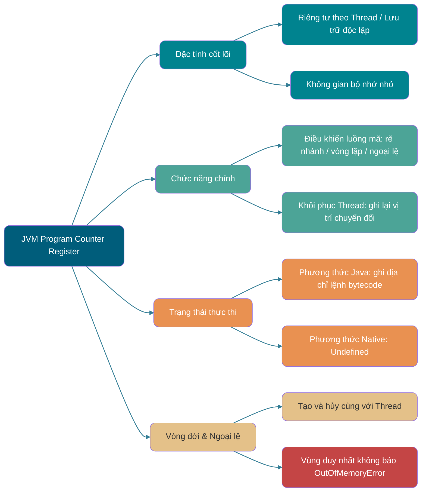
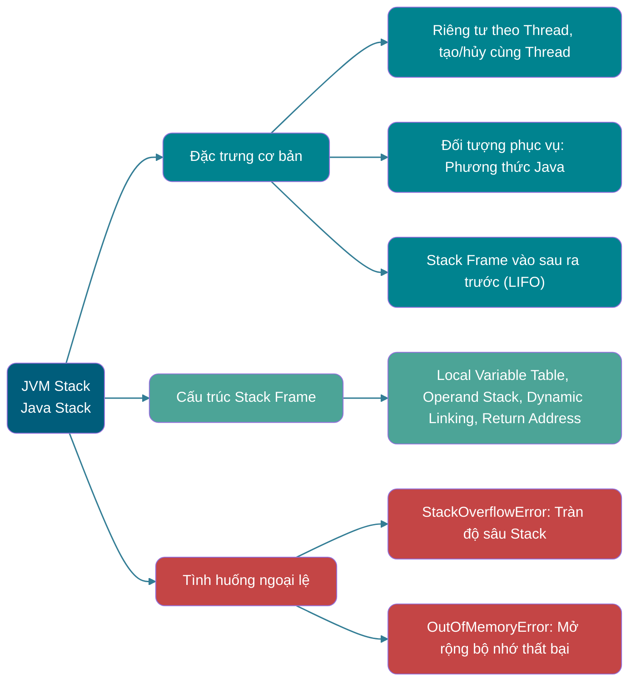
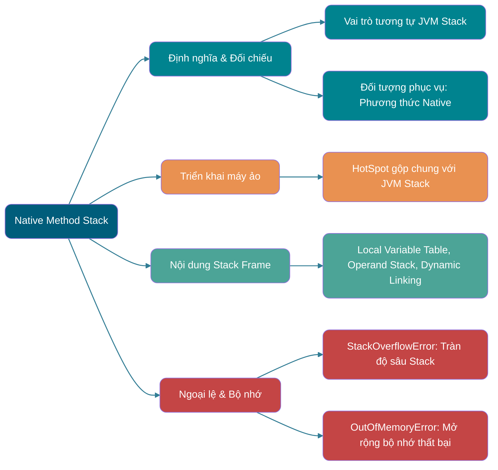
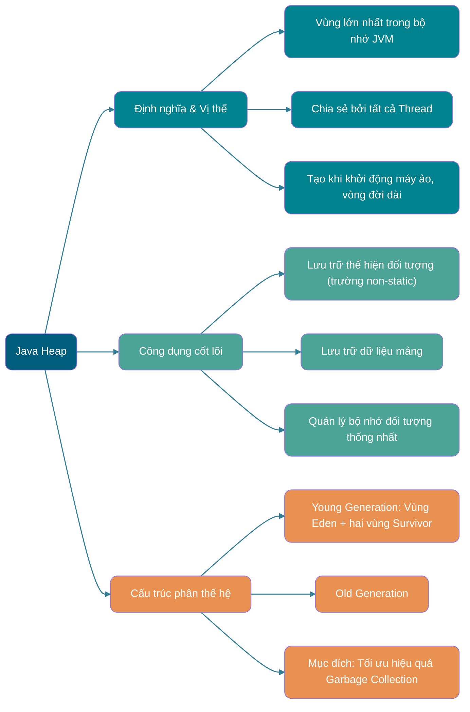
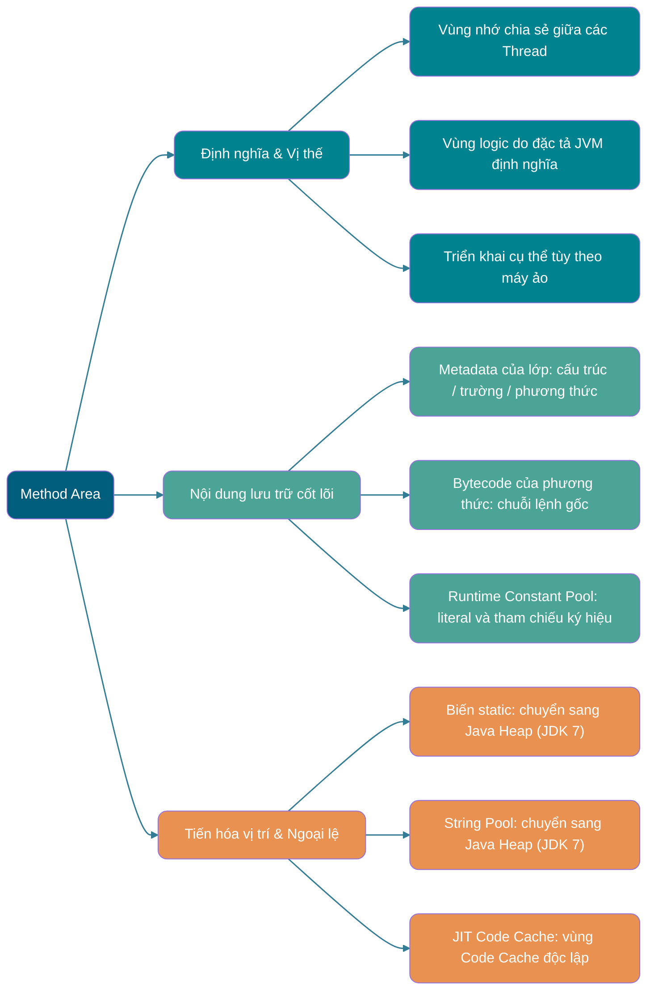
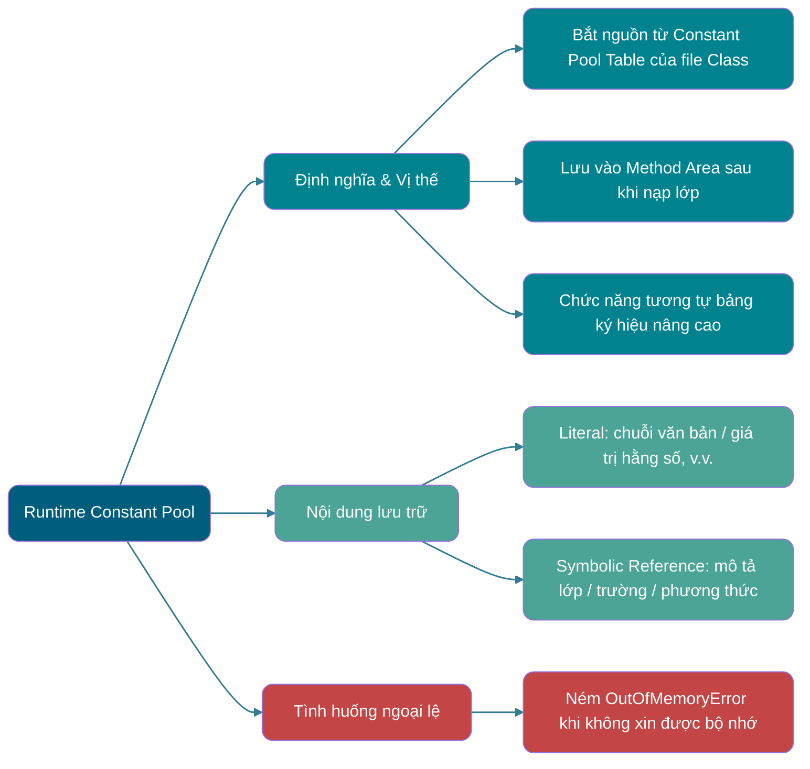
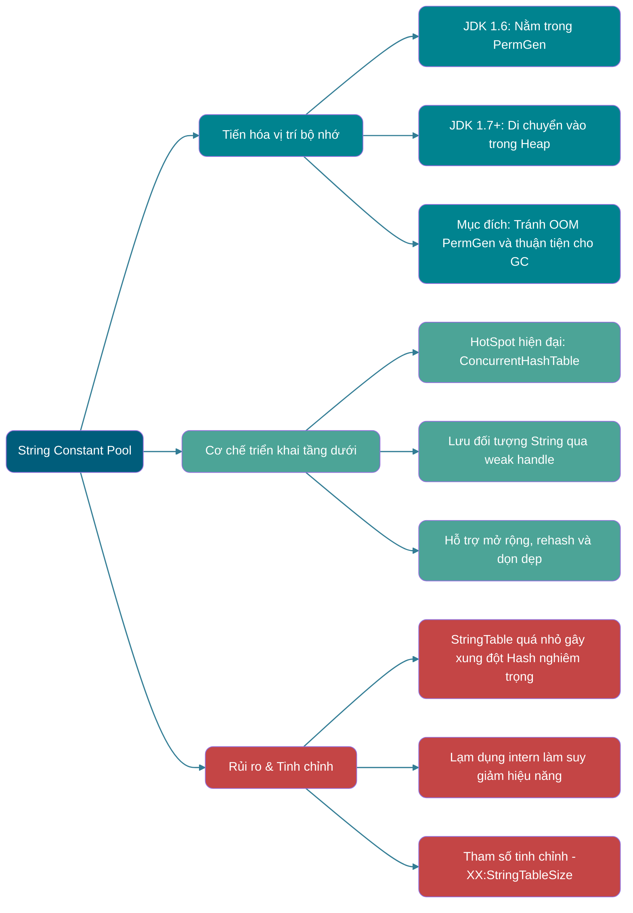
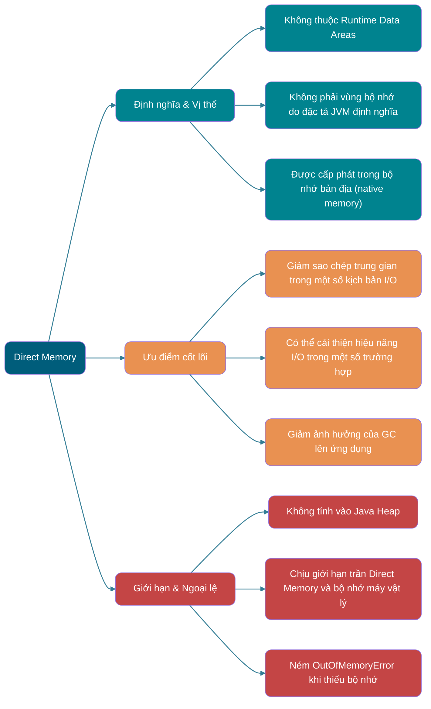
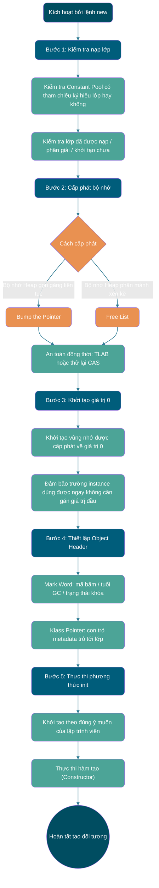

> Nếu không có chú thích đặc biệt nào khác, toàn bộ nội dung đều đề cập đến máy ảo HotSpot.
>
> Bài viết này được tổng hợp và bổ sung dựa trên cuốn *Hiểu sâu về Java Virtual Machine: Các tính năng nâng cao và phương pháp hay nhất (Understanding the Java Virtual Machine: JVM Advanced Features and Best Practices)*.
>
> Câu hỏi phỏng vấn thường gặp:
>
> - Giới thiệu về các vùng bộ nhớ trong Java (Runtime Data Areas).
> - Quá trình tạo một đối tượng Java (5 bước; khuyến nghị có thể viết lại từ trí nhớ và nắm rõ máy ảo đã làm gì ở từng bước).
> - Hai cách truy cập và định vị đối tượng (Handle và Direct Pointer).

## Lời mở đầu

Đối với lập trình viên Java, nhờ cơ chế quản lý bộ nhớ tự động của máy ảo, chúng ta không còn phải viết các thao tác `delete`/`free` tương ứng cho mỗi lệnh `new` như lập trình viên C/C++ nữa, nên ít xảy ra lỗi rò rỉ bộ nhớ (Memory Leak) và tràn bộ nhớ (`OOM`) hơn. Tuy nhiên, chính vì lập trình viên Java đã giao quyền kiểm soát bộ nhớ cho Java Virtual Machine, nên một khi xảy ra sự cố rò rỉ hay tràn bộ nhớ, nếu không hiểu cách máy ảo sử dụng bộ nhớ thì việc truy tìm và khắc phục lỗi sẽ là một nhiệm vụ vô cùng gian nan.

## Vùng dữ liệu thời gian chạy (Runtime Data Areas)

Trong quá trình thực thi chương trình Java, Java Virtual Machine sẽ chia vùng bộ nhớ mà nó quản lý thành nhiều vùng dữ liệu khác nhau.

JDK 1.8 có một chút khác biệt so với các phiên bản trước đó; ở đây chúng ta sẽ lấy hai phiên bản JDK 1.7 và JDK 1.8 làm ví dụ để giới thiệu.

**JDK 1.7**:


**JDK 1.8**:


**Dùng riêng cho từng Thread (Thread-private):**

- Program Counter Register (Thanh ghi bộ đếm chương trình)
- Java Virtual Machine Stack (JVM Stack)
- Native Method Stack

**Chia sẻ giữa các Thread (Thread-shared):**

- Heap
- Method Area

Direct Memory thường được thảo luận cùng với các vùng này, nhưng nó không phải là vùng dữ liệu thời gian chạy do *Đặc tả Java Virtual Machine* định nghĩa, và cũng không nên bị xem là một "vùng dữ liệu thời gian chạy chia sẻ giữa các Thread" theo chuẩn đặc tả.

Quy định của Đặc tả Java Virtual Machine đối với các vùng dữ liệu thời gian chạy là khá linh hoạt. Lấy Heap làm ví dụ: Heap có thể là vùng nhớ liên tục hoặc không liên tục. Kích thước của Heap có thể cố định hoặc mở rộng linh hoạt tại thời điểm chạy (runtime). Nhà phát triển máy ảo có thể sử dụng bất kỳ thuật toán Garbage Collection (GC) nào để quản lý Heap, thậm chí hoàn toàn không thực hiện thu gom rác cũng được.

### Program Counter Register



Program Counter Register (Thanh ghi bộ đếm chương trình) là một vùng bộ nhớ có kích thước tương đối nhỏ, có thể được xem như bộ chỉ báo số dòng của mã bytecode mà Thread hiện tại đang thực thi. Khi trình thông dịch bytecode (bytecode interpreter) hoạt động, nó chọn lệnh bytecode tiếp theo cần thực thi bằng cách thay đổi giá trị của bộ đếm này; các chức năng như rẽ nhánh, vòng lặp, nhảy lệnh, xử lý ngoại lệ và khôi phục Thread đều phải dựa vào bộ đếm này để hoàn thành.

Ngoài ra, để sau khi chuyển đổi ngữ cảnh (context switch) Thread có thể khôi phục đúng vị trí đang thực thi, mỗi Thread đều cần có một Program Counter Register riêng biệt. Bộ đếm giữa các Thread không ảnh hưởng lẫn nhau và được lưu trữ độc lập; chúng ta gọi loại vùng bộ nhớ này là bộ nhớ "dùng riêng cho từng Thread" (thread-private).

Từ phần giới thiệu trên, ta biết rằng Program Counter Register chủ yếu có hai vai trò:

- Trình thông dịch bytecode lần lượt đọc các lệnh bằng cách thay đổi giá trị của Program Counter Register, từ đó hiện thực hóa việc điều khiển luồng chạy của mã như thực thi tuần tự, rẽ nhánh, vòng lặp và xử lý ngoại lệ.
- Trong môi trường đa luồng (multithreading), Program Counter Register dùng để ghi lại vị trí thực thi hiện tại của Thread, nhờ vậy khi Thread được chuyển đổi quay trở lại thực thi, hệ thống biết được lần trước Thread đó đang chạy đến đâu.

Vòng đời của Program Counter Register hoàn toàn đồng bộ với Thread:

- **Khởi tạo**: Được tạo ra cùng với việc tạo Thread.
- **Hủy bỏ**: Bị hủy cùng với việc kết thúc Thread.

Khi thực thi một **phương thức Java** (không phải native), Program Counter Register ghi lại **địa chỉ của lệnh JVM bytecode đang được thực thi hiện tại**. Khi Thread thực thi một **phương thức native** (phương thức bản địa), giá trị của Program Counter Register là **Undefined (không xác định)**, vì lúc này thứ đang được thực thi không phải là các lệnh JVM bytecode.

⚠️ Lưu ý: Program Counter Register là vùng bộ nhớ duy nhất trong đặc tả JVM không quy định bất kỳ trường hợp lỗi `OutOfMemoryError` nào. Đặc tả chỉ quy định kết luận này, chứ không bắt buộc mọi bản triển khai đều phải dùng một dạng biểu diễn có kích thước cố định nào đó.

### Java Virtual Machine Stack (JVM Stack)



Giống như Program Counter Register, Java Virtual Machine Stack (sau đây gọi tắt là Stack) cũng dùng riêng cho từng Thread; vòng đời của nó giống hệt Thread—được tạo khi Thread được tạo và mất đi khi Thread kết thúc.

Stack chắc chắn là một thành phần cốt lõi trong vùng dữ liệu thời gian chạy của JVM. Ngoại trừ một số lời gọi phương thức Native được thực hiện thông qua Native Method Stack (sẽ đề cập sau), tất cả các lời gọi phương thức Java khác đều được thực hiện thông qua Stack (và cũng cần phối hợp với các vùng dữ liệu thời gian chạy khác như Program Counter Register).

Dữ liệu của lời gọi phương thức cần được truyền qua Stack; mỗi lần gọi phương thức sẽ có một Stack Frame tương ứng được đẩy vào Stack (push), và sau khi mỗi lời gọi phương thức kết thúc, một Stack Frame sẽ được lấy ra khỏi Stack (pop).

Stack được cấu thành từ từng Stack Frame, và bên trong mỗi Stack Frame đều có: Local Variable Table (bảng biến cục bộ), Operand Stack (ngăn xếp toán hạng), Dynamic Linking (liên kết động) và Return Address (địa chỉ trả về của phương thức). Tương tự cấu trúc dữ liệu ngăn xếp, cả hai đều là cấu trúc dữ liệu vào sau ra trước (LIFO), chỉ hỗ trợ hai thao tác pop và push.


**Local Variable Table (Bảng biến cục bộ)** chủ yếu lưu trữ các kiểu dữ liệu được xác định tại thời điểm biên dịch (`boolean`, `byte`, `char`, `short`, `int`, `float`, `long`, `double`) và tham chiếu đối tượng (kiểu `reference`—nó khác với bản thân đối tượng, có thể là con trỏ tham chiếu trỏ tới địa chỉ bắt đầu của đối tượng, hoặc trỏ tới một Handle đại diện cho đối tượng hay một vị trí khác liên quan đến đối tượng này).


**Operand Stack (Ngăn xếp toán hạng)** chủ yếu đóng vai trò trạm trung chuyển cho lời gọi phương thức, dùng để lưu trữ các kết quả tính toán trung gian phát sinh trong quá trình thực thi phương thức. Ngoài ra, các biến tạm phát sinh trong quá trình tính toán cũng được đặt vào Operand Stack.

**Dynamic Linking (Liên kết động)** là một chức năng của Stack Frame. Mỗi Stack Frame đều giữ một tham chiếu trỏ tới Runtime Constant Pool của kiểu chứa phương thức hiện tại, dùng để chuyển đổi các tham chiếu ký hiệu (symbolic reference) của phương thức trong mã phương thức thành tham chiếu phương thức cụ thể, và chuyển đổi truy cập biến thành độ dời (offset) trong cấu trúc lưu trữ thời gian chạy tương ứng; khi phân giải các ký hiệu chưa xác định, quá trình này còn có thể kích hoạt nạp lớp (Class Loading). Quá trình cần lựa chọn bản cài đặt phương thức ảo (virtual method) dựa trên kiểu thực tế của đối tượng tiếp nhận thuộc về cơ chế điều phối động (dynamic dispatch) của lệnh gọi phương thức, không thể đánh đồng đơn giản với Dynamic Linking ở đây.


Tuy không gian Stack không phải là vô hạn, nhưng trong các lời gọi thông thường nhìn chung sẽ không xảy ra vấn đề. Dẫu vậy, nếu hàm gọi bị rơi vào đệ quy vô hạn, quá nhiều Stack Frame sẽ bị đẩy vào Stack và chiếm dụng quá nhiều không gian, khiến độ sâu của Stack quá lớn. Khi đó, nếu độ sâu Stack mà Thread yêu cầu vượt quá độ sâu tối đa của Java Virtual Machine Stack hiện tại, lỗi `StackOverflowError` sẽ bị ném ra.

**Phương thức Java có hai cách trả về**:

- **Trả về bình thường**: Thực thi câu lệnh `return`, truyền giá trị trả về cho bên gọi.
- **Trả về do ngoại lệ**: Ném ra ngoại lệ trong quá trình thực thi phương thức mà không được bắt (catch).

Bất kể trả về theo cách nào, Stack Frame đều sẽ bị đẩy ra (pop). Nói cách khác, **Stack Frame được tạo ra khi gọi phương thức và bị hủy khi phương thức kết thúc. Dù phương thức hoàn thành bình thường hay hoàn thành do ngoại lệ thì đều được tính là kết thúc phương thức.**

Ngoài lỗi `StackOverflowError`, Stack còn có thể gặp lỗi `OutOfMemoryError`, nguyên nhân là nếu kích thước bộ nhớ của Stack có thể mở rộng động, thì khi máy ảo không thể cấp phát đủ không gian bộ nhớ trong lúc mở rộng Stack, ngoại lệ `OutOfMemoryError` sẽ được ném ra.

Tóm tắt ngắn gọn hai loại lỗi có thể xảy ra ở Stack trong quá trình chạy chương trình:

- **`StackOverflowError`:** Khi không gian Stack mà Thread cần để thực thi vượt quá giới hạn cho phép của JVM, lỗi `StackOverflowError` sẽ được ném ra.
- **`OutOfMemoryError`:** Nếu kích thước bộ nhớ Stack có thể mở rộng động, khi máy ảo không xin cấp phát được đủ bộ nhớ trong lúc mở rộng Stack động, ngoại lệ `OutOfMemoryError` sẽ được ném ra.


### Native Method Stack



Vai trò của vùng này rất giống với JVM Stack, điểm khác biệt là: **JVM Stack phục vụ các phương thức Java (tức là bytecode) do máy ảo thực thi, còn Native Method Stack phục vụ các phương thức Native mà máy ảo sử dụng.** Trong máy ảo HotSpot, vùng này được gộp làm một với Java Virtual Machine Stack.

Khi thực thi phương thức Native, bản triển khai máy ảo có thể sử dụng ngăn xếp bản địa truyền thống (thường gọi là C stack). *Đặc tả Java Virtual Machine* không bắt buộc Native Method Stack phải áp dụng cấu trúc Local Variable Table, Operand Stack và Dynamic Linking giống như Stack Frame của JVM.

Sau khi phương thức Native thực thi xong, dữ liệu ngăn xếp tương ứng phụ thuộc vào bản triển khai sẽ được giải phóng. Native Method Stack cũng có thể xuất hiện hai lỗi là `StackOverflowError` và `OutOfMemoryError`.

### Heap



Java Heap là vùng bộ nhớ lớn nhất do Java Virtual Machine quản lý; Java Heap là vùng bộ nhớ được chia sẻ giữa tất cả các Thread và được tạo ra khi máy ảo khởi động. **Mục đích duy nhất của vùng bộ nhớ này là lưu trữ các thể hiện đối tượng (object instance); hầu như mọi thể hiện đối tượng cũng như mảng đều được cấp phát bộ nhớ tại đây.**

Trong thế giới Java, "hầu như" mọi đối tượng đều được cấp phát trên Heap. Tuy nhiên, trình biên dịch JIT có thể thực hiện thay thế vô hướng (Scalar Replacement) dựa trên phân tích thoát (Escape Analysis), qua đó loại bỏ việc cấp phát thực tế của một số đối tượng. Loại tối ưu này trong HotSpot không thể diễn đạt đơn giản là "đối tượng được cấp phát trực tiếp trên Java Virtual Machine Stack".

Java Heap là khu vực chính được bộ thu gom rác (Garbage Collector) quản lý, vì vậy còn được gọi là **GC Heap (Garbage Collected Heap)**. Xét dưới góc độ Garbage Collection, do các bộ thu gom hiện nay cơ bản đều sử dụng thuật toán thu gom rác phân thế hệ (generational GC), nên Java Heap còn có thể chia nhỏ thành: Young Generation (thế hệ trẻ) và Old Generation (thế hệ già); chi tiết hơn nữa thì có các vùng Eden, Survivor, Old, v.v. Mục đích của việc chia nhỏ hơn nữa là để thu hồi bộ nhớ tốt hơn hoặc cấp phát bộ nhớ nhanh hơn.

Trong HotSpot từ JDK 7 trở về trước, GC thường được giới thiệu theo ba phần dưới đây, trong đó Permanent Generation là bản triển khai của Method Area và không thuộc Java Heap:

1. Young Generation (Vùng thế hệ trẻ)
2. Old Generation (Vùng thế hệ già)
3. Permanent Generation (Vùng thế hệ vĩnh viễn)

Trong hình minh họa dưới đây, vùng Eden và hai vùng Survivor S0, S1 đều thuộc Young Generation, lớp ở giữa thuộc Old Generation, và lớp dưới cùng thuộc Permanent Generation.


**Từ phiên bản JDK 8 trở đi, PermGen (Permanent Generation) đã được thay thế bằng Metaspace, và Metaspace sử dụng bộ nhớ bản địa (native memory).** (Tôi sẽ trình bày chi tiết ở phần Method Area).

Trong phần lớn trường hợp, đối tượng đều sẽ được cấp phát trước ở vùng Eden; sau một lần Garbage Collection ở Young Generation, nếu đối tượng còn sống sót thì sẽ chuyển sang S0 hoặc S1, đồng thời tuổi (age) của đối tượng sẽ tăng thêm 1 (sau khi từ vùng Eden -> vùng Survivor, tuổi ban đầu của đối tượng trở thành 1). Khi đạt tới ngưỡng tuổi thăng cấp (tenuring threshold), đối tượng sẽ đi vào Old Generation; ngưỡng này chịu ảnh hưởng đồng thời bởi bộ thu gom, chiến lược thích ứng và tham số `-XX:MaxTenuringThreshold`, không phải bộ thu gom nào cũng có giá trị mặc định là 15. Đối với các bộ thu gom phân thế hệ kinh điển sử dụng trường tuổi 4 bit, giới hạn trên của tham số này là 15.

```bash
MaxTenuringThreshold of 20 is invalid; must be between 0 and 15
```

**Tại sao tuổi chỉ có thể nằm trong khoảng 0–15?**

Bởi vì phần lưu trữ tuổi nằm trong Object Header (đầu đối tượng), và kích thước của trường này thường là 4 bit. Số nhị phân lớn nhất mà 4 bit có thể biểu diễn là `1111`, tức số 15 trong hệ thập phân. Do đó, tuổi của đối tượng bị giới hạn từ 0 đến 15.

Tại đây chúng ta giới thiệu sơ lược kết hợp với bố cục bộ nhớ của đối tượng (Object Layout).

Trong máy ảo HotSpot, bố cục lưu trữ của đối tượng trong bộ nhớ có thể chia thành 3 phần: Object Header (Header), Instance Data (dữ liệu thể hiện) và Padding (phần đệm căn chỉnh). Trong đó, Object Header gồm hai phần: Mark Word (trường đánh dấu) và Klass Word (con trỏ kiểu - Klass pointer). Phần giới thiệu chi tiết về bố cục bộ nhớ đối tượng sẽ được trình bày ở phía sau, nên sẽ không lặp lại ở đây.

Thông tin tuổi này được lưu trong Mark Word (Mark Word còn lưu các thông tin khác của bản thân đối tượng như mã băm hash code, thông tin trạng thái khóa, v.v.). File `markOop.hpp` trong mã nguồn HotSpot phiên bản cũ dưới đây minh họa cấu trúc Mark Word tại thời điểm đó; bản triển khai tương ứng và bố cục Object Header trong các phiên bản JDK hiện đại đã có sự thay đổi:


Có thể thấy kích thước mà tuổi đối tượng chiếm dụng đúng là 4 bit.

> **🐛 Đính chính (xem: [issue552](https://github.com/Snailclimb/JavaGuide/issues/552))**: "Khi HotSpot duyệt tất cả các đối tượng, nó sẽ cộng dồn dung lượng chiếm dụng của các đối tượng theo thứ tự tuổi từ nhỏ đến lớn; khi tổng dung lượng cộng dồn đến một độ tuổi nào đó vượt quá một nửa dung lượng vùng Survivor, hệ thống sẽ lấy giá trị nhỏ hơn giữa độ tuổi này và `MaxTenuringThreshold` làm ngưỡng tuổi thăng cấp mới".
>
> **Mã nguồn tính tuổi động như sau:**
>
> ```c++
> uint ageTable::compute_tenuring_threshold(size_t survivor_capacity) {
>  // survivor_capacity là kích thước của không gian survivor
> size_t desired_survivor_size = (size_t)((((double) survivor_capacity)*TargetSurvivorRatio)/100);// TargetSurvivorRatio là 50
> size_t total = 0;
> uint age = 1;
> while (age < table_size) {
> total += sizes[age];// Mảng sizes là tổng kích thước đối tượng ở mỗi độ tuổi
> if (total > desired_survivor_size) break;
> age++;
> }
> uint result = age < MaxTenuringThreshold ? age : MaxTenuringThreshold;
>   ...
> }
> ```

Tại vùng Heap, lỗi dễ xuất hiện nhất là `OutOfMemoryError`, và sau khi lỗi này xảy ra thì có thể biểu hiện dưới vài dạng khác nhau, ví dụ:

1. **`java.lang.OutOfMemoryError: GC Overhead Limit Exceeded`**: Lỗi này xảy ra khi JVM dành quá nhiều thời gian để thực hiện Garbage Collection nhưng chỉ thu hồi được rất ít không gian Heap.
2. **`java.lang.OutOfMemoryError: Java heap space`**: Khi tạo đối tượng mới, nếu không gian còn lại trong bộ nhớ Heap không đủ để chứa đối tượng mới tạo thì sẽ gây ra lỗi này. (Liên quan đến kích thước Heap tối đa được cấu hình và bị giới hạn bởi dung lượng bộ nhớ vật lý. Bộ nhớ Heap tối đa có thể cấu hình qua tham số `-Xmx`; nếu không cấu hình riêng sẽ dùng giá trị mặc định, xem chi tiết tại: [Default Java 8 max heap size](https://stackoverflow.com/questions/28272923/default-xmxsize-in-java-8-max-heap-size))
3. ...

### Method Area



Method Area là một vùng logic thuộc vùng dữ liệu thời gian chạy của JVM, là vùng nhớ được chia sẻ giữa các Thread.

*Đặc tả Java Virtual Machine* chỉ quy định rằng tồn tại khái niệm Method Area cùng với vai trò của nó, còn việc triển khai Method Area cụ thể như thế nào là việc mà tự mỗi máy ảo phải cân nhắc. Nói cách khác, trên các bản triển khai máy ảo khác nhau, cách hiện thực hóa Method Area sẽ khác nhau.

Khi máy ảo nạp một lớp, nó sẽ phân giải thông tin tương ứng từ file Class và lưu **metadata (siêu dữ liệu)** đó vào Method Area. Cụ thể, Method Area chủ yếu lưu trữ các dữ liệu cốt lõi sau:

1. **Metadata của lớp**: Bao gồm cấu trúc đầy đủ của lớp như tên lớp, lớp cha, các interface được cài đặt, access modifier (từ khóa bổ nghĩa truy cập), cùng thông tin chi tiết của các trường và phương thức (tên, kiểu, modifier, v.v.).
2. **Bytecode của phương thức**: Chuỗi lệnh gốc của mỗi phương thức.
3. **Runtime Constant Pool**: Riêng biệt cho từng lớp, được chuyển đổi từ Constant Pool Table trong file Class, dùng để lưu trữ các loại literal sinh ra tại thời điểm biên dịch và các tham chiếu ký hiệu (symbolic reference) tới kiểu, trường và phương thức.

Cần đặc biệt lưu ý rằng các loại dữ liệu dưới đây tuy về mặt logic có liên quan đến lớp, nhưng trong máy ảo HotSpot, chúng không được lưu trữ bên trong Method Area:

- **Biến static (Static Variables)**: Kể từ JDK 7, các biến static của lớp được lưu trong Java Heap cùng với đối tượng `java.lang.Class` tương ứng.
- **String Constant Pool (String Pool)**: Tương tự, kể từ JDK 7, String Constant Pool cũng **được di chuyển vào trong Java Heap**.
- **Bộ nhớ đệm mã sau khi trình biên dịch JIT biên dịch (JIT Code Cache)**: Mã máy bản địa (native machine code) được trình biên dịch JIT biên dịch từ bytecode của các phương thức nóng (hot method) được lưu trong một **vùng bộ nhớ độc lập mang tên "Code Cache"**, chứ không nằm trong chính Method Area. Làm như vậy nhằm đạt được hiệu quả thực thi và quản lý bộ nhớ tốt hơn.


**Mối quan hệ giữa Method Area, Permanent Generation và Metaspace là gì?** Mối quan hệ giữa Method Area với Permanent Generation và Metaspace rất giống mối quan hệ giữa interface và class trong Java: class cài đặt (implement) interface. Ở đây có thể xem class là Permanent Generation và Metaspace, còn interface là Method Area; tức là Permanent Generation và Metaspace là hai cách triển khai của máy ảo HotSpot đối với Method Area trong đặc tả JVM. Hơn nữa, Permanent Generation là bản triển khai Method Area trước JDK 1.8, còn từ JDK 1.8 trở đi bản triển khai Method Area đã trở thành Metaspace.


**Tại sao lại thay thế Permanent Generation (PermGen) bằng Metaspace?**

Hình dưới đây trích từ *Hiểu sâu về Java Virtual Machine* ấn bản thứ 3, mục 2.2.5:


1. Dung lượng của Permanent Generation bị ràng buộc bởi giới hạn trên `-XX:MaxPermSize` và giới hạn này có thể cấu hình được; Metaspace chuyển sang dùng bộ nhớ bản địa (native memory) và có thể giới hạn qua `-XX:MaxMetaspaceSize`. Cả hai đều có thể bị tràn bộ nhớ (`OOM`), rủi ro thực tế phụ thuộc vào cấu hình và mức độ tăng trưởng metadata của các lớp.

> Khi Metaspace bị tràn sẽ nhận được lỗi sau: `java.lang.OutOfMemoryError: Metaspace`

Bạn có thể sử dụng `-XX:MaxMetaspaceSize` để thiết lập kích thước tối đa của Metaspace. Nếu không thiết lập, không gian metadata của lớp có thể tiếp tục tăng cho đến khi bị giới hạn bởi các điều kiện như bộ nhớ bản địa khả dụng. `-XX:MetaspaceSize` không phải là dung lượng ban đầu của Metaspace, mà là ngưỡng mức cao (high-water mark) ban đầu để kích hoạt GC cho metadata; sau đó JVM sẽ tự động điều chỉnh ngưỡng này.

2. Bên trong Metaspace lưu trữ metadata của các lớp, nhờ vậy số lượng metadata lớp có thể nạp vào không còn bị kiểm soát bởi `MaxPermSize`, mà được quyết định bởi không gian khả dụng thực tế của hệ thống, nên có thể nạp được nhiều lớp hơn.

3. Vào thời điểm JDK 8, khi hợp nhất mã nguồn của HotSpot và JRockit, JRockit vốn chưa từng có thứ gì gọi là Permanent Generation, nên sau khi hợp nhất không cần thiết phải duy trì thêm một vùng Permanent Generation riêng nữa.

4. Permanent Generation mang lại độ phức tạp không cần thiết cho GC, đồng thời hiệu suất thu hồi cũng khá thấp.

**Các tham số thường dùng cho Method Area là gì?**

Trước JDK 1.8, khi Permanent Generation chưa bị loại bỏ hoàn toàn, người ta thường dùng các tham số sau để điều chỉnh kích thước Method Area:

```java
-XX:PermSize=N // Kích thước ban đầu của Method Area (PermGen)
-XX:MaxPermSize=N // Kích thước tối đa của Method Area (PermGen); vượt quá giá trị này sẽ ném OutOfMemoryError: java.lang.OutOfMemoryError: PermGen
```

Nói một cách tương đối, hoạt động Garbage Collection ở khu vực này ít xảy ra hơn, nhưng không phải dữ liệu cứ đi vào Method Area là sẽ "tồn tại vĩnh viễn".

Đến JDK 1.8, Method Area (PermGen của HotSpot) đã bị loại bỏ hoàn toàn (quá trình này đã bắt đầu từ JDK 1.7) và được thay thế bằng Metaspace; Metaspace sử dụng bộ nhớ bản địa. Dưới đây là một số tham số thường dùng:

```java
-XX:MetaspaceSize=N // Thiết lập ngưỡng mức cao ban đầu để kích hoạt GC cho metadata
-XX:MaxMetaspaceSize=N // Thiết lập kích thước tối đa của Metaspace
```

Điểm khác biệt lớn so với Permanent Generation là nếu không chỉ định `MaxMetaspaceSize`, Metaspace sẽ không có giới hạn cố định do tham số này đặt ra; việc metadata của các lớp liên tục tăng lên có thể tiêu tốn lượng lớn bộ nhớ bản địa.

### Runtime Constant Pool



Trong file Class, ngoài các thông tin mô tả như phiên bản lớp, trường (field), phương thức (method), interface, còn có **Constant Pool Table (bảng hồ hằng số)** dùng để lưu trữ các loại literal (giá trị hằng nguyên bản) và symbolic reference (tham chiếu ký hiệu) được sinh ra tại thời điểm biên dịch.

Literal là cách biểu diễn giá trị cố định trong mã nguồn, tức là nhìn trực tiếp vào mặt chữ là có thể biết được ý nghĩa giá trị của nó. Literal bao gồm số nguyên, số dấu phẩy động và chuỗi literal. Các tham chiếu ký hiệu phổ biến bao gồm tham chiếu ký hiệu lớp, tham chiếu ký hiệu trường, tham chiếu ký hiệu phương thức và tham chiếu ký hiệu phương thức interface.

Mục 7.3.4 trong cuốn *Hiểu sâu về Java Virtual Machine* ấn bản thứ 3 giải thích về tham chiếu ký hiệu (Symbolic Reference) và tham chiếu trực tiếp (Direct Reference) như sau:


Constant Pool Table sẽ được lưu vào Runtime Constant Pool trong Method Area sau khi lớp được nạp.

Chức năng của Runtime Constant Pool tương tự như bảng ký hiệu (symbol table) trong các ngôn ngữ lập trình truyền thống, mặc dù nó chứa phạm vi dữ liệu rộng hơn so với một bảng ký hiệu điển hình.

Vì Runtime Constant Pool là một phần của Method Area, tự nhiên nó cũng chịu giới hạn bộ nhớ của Method Area; khi Runtime Constant Pool không thể xin cấp phát thêm bộ nhớ được nữa, lỗi `OutOfMemoryError` sẽ được ném ra.

### String Constant Pool (String Pool)



**String Constant Pool (String Pool)** là một vùng bộ nhớ được JVM mở riêng cho chuỗi (lớp `String`) nhằm nâng cao hiệu năng và giảm mức tiêu thụ bộ nhớ, với mục đích chính là tránh việc tạo trùng lặp các chuỗi giống nhau.

```java
// 1. Tra cứu đối tượng chuỗi "ab" trong String Constant Pool; nếu chưa có thì tạo "ab" và đưa vào String Constant Pool
// 2. Gán tham chiếu của đối tượng chuỗi "ab" cho aa
String aa = "ab";
// Trả về trực tiếp đối tượng chuỗi "ab" trong String Constant Pool và gán cho tham chiếu bb
String bb = "ab";
System.out.println(aa==bb); // true
```

Bản triển khai String Constant Pool trong máy ảo HotSpot có thể xem tại `src/hotspot/share/classfile/stringTable.cpp`. `StringTable` bản địa của HotSpot hiện đại sử dụng bảng băm đồng thời (concurrent hash table) và lưu trữ các đối tượng chuỗi trên Heap thông qua các weak handle, hỗ trợ mở rộng dung lượng, băm lại (rehash) và dọn dẹp các mục không còn hiệu lực; `-XX:StringTableSize` được dùng để thiết lập số bucket ban đầu. Do đó, cách nói "mảng độ dài cố định + danh sách liên kết" chỉ đúng với một số bản triển khai cũ, không thể khái quát cho HotSpot hiện tại.

Trước JDK 1.7, String Constant Pool được lưu trong Permanent Generation. JDK 1.7 đã di chuyển String Constant Pool và các biến static của lớp vào trong Java Heap.


**Tại sao JDK 1.7 lại chuyển String Constant Pool vào Heap?**

Chủ yếu là vì hiệu quả thu hồi GC của Permanent Generation (bản triển khai của Method Area) quá thấp—GC tại đây chỉ được thực thi khi xảy ra Full GC. Trong chương trình Java thường có một lượng lớn chuỗi được tạo ra chờ thu hồi; việc đưa String Constant Pool vào trong Heap giúp thu hồi bộ nhớ của các chuỗi hiệu quả và kịp thời hơn.

Câu hỏi liên quan: [JVM Constant Pool lưu trữ đối tượng hay tham chiếu? - RednaxelaFX - Zhihu](https://www.zhihu.com/question/57109429/answer/151717241)

Cuối cùng xin chia sẻ một đoạn nhận xét của tác giả Chu Chí Minh (Zhou Zhiming) trong [issue#112](https://github.com/fenixsoft/jvm_book/issues/112) tại kho lưu trữ GitHub [Mã mẫu & đính chính sách *Hiểu sâu về Java Virtual Machine (Ấn bản thứ 3)*](https://github.com/fenixsoft/jvm_book):

> **Runtime Constant Pool, Method Area và String Constant Pool đều là các khái niệm logic không thay đổi theo từng bản triển khai máy ảo—chúng mang tính công cộng và trừu tượng; còn Metaspace và Heap là các khái niệm vật lý gắn liền với một bản triển khai máy ảo cụ thể—chúng mang tính riêng tư và cụ thể.**

### Direct Memory (Bộ nhớ trực tiếp)



Direct Memory là một loại vùng đệm bộ nhớ đặc biệt, không được cấp phát trong Java Heap hay Method Area mà được cấp phát trong bộ nhớ bản địa (native memory). Cơ chế cấp phát cụ thể thuộc về chi tiết cài đặt của máy ảo, không đồng nghĩa với việc bắt buộc phải cấp phát thông qua JNI.

Direct Memory không phải là một phần của Runtime Data Areas của máy ảo, cũng không phải là vùng bộ nhớ được định nghĩa trong *Đặc tả Java Virtual Machine*, nhưng phần bộ nhớ này lại được sử dụng rất thường xuyên và cũng có thể dẫn đến lỗi `OutOfMemoryError`.

**NIO (New I/O)** mới được bổ sung trong JDK 1.4 đã giới thiệu một phương thức I/O dựa trên **Channel (kênh)** và **Buffer (vùng đệm)**. Direct byte buffer có thể cấp phát nội dung ở bên ngoài Java Heap và thao tác thông qua đối tượng `DirectByteBuffer` nằm trong Java Heap. JVM sẽ cố gắng thực hiện I/O bản địa trực tiếp trên loại vùng đệm này, nhờ đó giảm bớt việc sao chép dữ liệu qua vùng đệm trung gian trong một số kịch bản; trong NIO chỉ có các thành phần như kênh có thể chọn (selectable channel) và Selector mới cung cấp năng lực Non-blocking I/O, không thể diễn giải toàn bộ NIO thành "Non-Blocking I/O".

Direct Memory không tính vào Java Heap, nhưng vẫn chịu giới hạn bởi tổng dung lượng bộ nhớ của máy chủ, không gian định địa chỉ của bộ xử lý và các điều kiện khác. Đối với vùng đệm trực tiếp của NIO, còn có thể giới hạn tổng lượng cấp phát bằng tham số [`-XX:MaxDirectMemorySize`](https://docs.oracle.com/en/java/javase/25/docs/specs/man/java.html#extra-options-for-java).

Một khái niệm tương tự khác là **Off-heap Memory (bộ nhớ ngoài Heap)**. Trong một số bài viết người ta đánh đồng Direct Memory với Off-heap Memory, cá nhân tôi thấy điều đó chưa thật sự chính xác.

Off-heap Memory là tên gọi chung cho vùng bộ nhớ được cấp phát bên ngoài Java Heap, tầng dưới thường sử dụng bộ nhớ bản địa do hệ điều hành cung cấp. Việc nó có được JVM hoặc JDK quản lý hay không và quản lý bằng cách nào sẽ phụ thuộc vào phương thức cấp phát cụ thể. Ví dụ, trong OpenJDK/HotSpot, bộ nhớ bản địa tương ứng với `DirectByteBuffer` sẽ được liên kết với đối tượng buffer nằm trong Java Heap, và sau khi đối tượng trở nên không thể tiếp cận (unreachable), nó sẽ tham gia vào quá trình dọn dẹp thông qua các cơ chế như `Cleaner`. Vì thời điểm dọn dẹp không do ứng dụng kiểm soát trực tiếp, việc sử dụng Off-heap Memory tuy có thể giảm áp lực cho Java Heap, nhưng vẫn cần chú ý đến rò rỉ bộ nhớ bản địa và lỗi `OutOfMemoryError`.

## Khám phá đối tượng trong máy ảo HotSpot

Qua phần giới thiệu ở trên, chúng ta đã nắm được đại khái tình hình bộ nhớ của máy ảo; dưới đây chúng ta hãy tìm hiểu chi tiết toàn bộ quá trình cấp phát, bố cục và truy cập đối tượng trong Java Heap của máy ảo HotSpot.

### Quá trình tạo đối tượng

Với quá trình tạo đối tượng Java, tôi khuyên tốt nhất bạn nên viết thuộc lòng được và nắm rõ từng bước đang làm gì.



#### Bước 1: Kiểm tra nạp lớp

Khi máy ảo gặp một lệnh `new`, trước tiên nó sẽ kiểm tra xem tham số của lệnh này có thể định vị được một tham chiếu ký hiệu của lớp đó trong Constant Pool hay không, đồng thời kiểm tra xem lớp mà tham chiếu ký hiệu này đại diện đã được nạp (load), phân giải (resolve) và khởi tạo (initialize) hay chưa. Nếu chưa, bắt buộc phải thực hiện quá trình nạp lớp (Class Loading) tương ứng trước.

#### Bước 2: Cấp phát bộ nhớ

Sau khi **kiểm tra nạp lớp** thông qua, tiếp theo máy ảo sẽ **cấp phát bộ nhớ** cho đối tượng mới sinh. Kích thước bộ nhớ mà đối tượng cần có thể xác định được ngay sau khi nạp lớp xong; nhiệm vụ cấp phát không gian cho đối tượng tương đương với việc cắt ra một khối bộ nhớ có kích thước xác định từ Java Heap. Có hai **phương thức cấp phát** là **"Bump the Pointer (dịch chuyển con trỏ)"** và **"Free List (danh sách trống)"**; **việc chọn phương thức nào phụ thuộc vào bộ nhớ Java Heap có gọn gàng liên tục hay không, mà việc Java Heap có gọn gàng liên tục hay không lại phụ thuộc vào bộ thu gom rác được sử dụng có chức năng nén sắp xếp (compaction) hay không**.

**Hai phương thức cấp phát bộ nhớ** (nội dung bổ sung, cần nắm vững):

- Bump the Pointer (Dịch chuyển con trỏ):
  - Trường hợp áp dụng: Khi bộ nhớ Heap gọn gàng liên tục (tức là không có phân mảnh bộ nhớ).
  - Nguyên lý: Toàn bộ bộ nhớ đã dùng được dồn về một phía, bộ nhớ chưa dùng đặt ở phía còn lại, ở giữa có một con trỏ phân giới; chỉ cần dịch chuyển con trỏ này về phía vùng bộ nhớ chưa dùng một đoạn đúng bằng kích thước bộ nhớ của đối tượng là được.
  - Các bộ thu gom GC dùng phương thức cấp phát này: Serial, ParNew.
- Free List (Danh sách trống):
  - Trường hợp áp dụng: Khi bộ nhớ Heap không gọn gàng liên tục (bị phân mảnh).
  - Nguyên lý: Máy ảo sẽ duy trì một danh sách ghi lại các khối bộ nhớ nào đang khả dụng; khi cấp phát, nó tìm một khối bộ nhớ đủ lớn để chia cho thể hiện đối tượng, cuối cùng cập nhật lại bản ghi trong danh sách.
  - Bộ thu gom GC dùng phương thức cấp phát này: CMS.

Lựa chọn cách nào trong hai cách trên phụ thuộc vào việc bộ nhớ Java Heap có gọn gàng liên tục hay không. Mà bộ nhớ Java Heap có gọn gàng liên tục hay không lại phụ thuộc vào thuật toán của bộ thu gom GC là "Mark-Sweep" (Đánh dấu - Quét) hay "Mark-Compact" (Đánh dấu - Sắp xếp / Đánh dấu - Nén); đáng chú ý là vùng nhớ của thuật toán Copying (Sao chép) cũng gọn gàng liên tục.

**Vấn đề đồng thời khi cấp phát bộ nhớ (nội dung bổ sung, cần nắm vững)**

Khi tạo đối tượng có một vấn đề rất quan trọng, đó là an toàn luồng (Thread Safety), bởi vì trong quá trình phát triển thực tế việc tạo đối tượng diễn ra rất thường xuyên; đứng trên góc độ máy ảo thì bắt buộc phải đảm bảo an toàn cho các Thread. Thông thường, máy ảo áp dụng hai cách để đảm bảo an toàn luồng:

- **CAS + thử lại khi thất bại:** CAS là một cách triển khai của khóa lạc quan (`Optimistic Lock`). Khóa lạc quan nghĩa là mỗi lần thực hiện thao tác đều không khóa mà giả định rằng không có xung đột; nếu thất bại vì xung đột thì thử lại cho đến khi thành công. **Máy ảo sử dụng CAS kết hợp với việc thử lại khi thất bại để đảm bảo tính nguyên tử (`Atomicity`) cho thao tác cập nhật.**
- **TLAB:** Cấp phát trước cho mỗi Thread một vùng nhớ nhỏ trong vùng Eden (Thread Local Allocation Buffer). Khi JVM cấp phát bộ nhớ cho đối tượng trong một Thread, trước tiên nó sẽ cấp phát trong TLAB; chỉ khi đối tượng lớn hơn phần bộ nhớ còn lại của TLAB hoặc TLAB đã dùng hết thì mới quay sang dùng CAS để cấp phát bộ nhớ.

#### Bước 3: Khởi tạo giá trị 0

Sau khi cấp phát bộ nhớ hoàn tất, máy ảo cần khởi tạo toàn bộ không gian bộ nhớ vừa được cấp phát về giá trị 0 (không bao gồm Object Header). Bước này đảm bảo các trường thể hiện (instance field) của đối tượng có thể sử dụng trực tiếp trong mã Java mà không cần gán giá trị ban đầu; chương trình sẽ đọc được giá trị 0 tương ứng với kiểu dữ liệu của các trường đó.

#### Bước 4: Thiết lập Object Header

Sau khi hoàn thành khởi tạo giá trị 0, **máy ảo cần thực hiện các thiết lập cần thiết cho đối tượng**, ví dụ đối tượng này là thể hiện của lớp nào, làm sao tìm thấy thông tin metadata của lớp, mã băm (hash code) của đối tượng, tuổi phân thế hệ GC của đối tượng và các thông tin khác. **Những thông tin này được lưu trong Object Header.** Ngoài ra, bố cục cụ thể của Object Header phụ thuộc vào phiên bản JDK và cấu hình máy ảo; ví dụ Biased Lock đã bị tắt mặc định từ JDK 15, và phần triển khai liên quan sau đó cũng đã bị loại bỏ.

#### Bước 5: Thực thi phương thức `<init>`

Sau khi các công việc trên hoàn tất, đứng từ góc nhìn của máy ảo thì một đối tượng mới đã được tạo ra, nhưng đứng từ góc nhìn của chương trình Java thì việc tạo đối tượng mới chỉ vừa bắt đầu—phương thức `<init>` vẫn chưa được thực thi, tất cả các trường đều còn ở giá trị 0. Vì vậy thông thường, sau khi thực thi lệnh `new` sẽ tiếp tục thực thi phương thức `<init>` để khởi tạo đối tượng theo đúng ý muốn của lập trình viên; đến lúc này một đối tượng thực sự khả dụng mới coi như được sinh ra hoàn chỉnh.

### Bố cục bộ nhớ của đối tượng (Object Memory Layout)

Trong máy ảo HotSpot, bố cục của đối tượng trong bộ nhớ có thể chia làm 3 vùng: **Object Header (Header)**, **Instance Data (dữ liệu thể hiện)** và **Padding (phần đệm căn chỉnh)**.

Object Header bao gồm hai phần thông tin:

1. Mark Word (Trường đánh dấu): Dùng để lưu dữ liệu thời gian chạy của bản thân đối tượng, như mã băm (`HashCode`), tuổi phân thế hệ GC, trạng thái khóa, v.v.; ID Thread thiên vị (biased thread ID) và dấu thời gian thiên vị (biased timestamp) chỉ áp dụng cho các phiên bản HotSpot cũ vẫn còn triển khai và bật Biased Lock.
2. Klass Pointer (Con trỏ kiểu): Con trỏ từ đối tượng trỏ tới metadata lớp của nó; máy ảo thông qua con trỏ này để xác định đối tượng này là thể hiện của lớp nào.

**Phần Instance Data là thông tin hữu ích thực sự được đối tượng lưu trữ**, cũng chính là nội dung của các trường thuộc nhiều kiểu khác nhau được định nghĩa trong chương trình.

**Phần Padding không nhất thiết phải tồn tại và cũng không mang ý nghĩa đặc biệt gì, nó chỉ đóng vai trò lấp chỗ cho đủ căn chỉnh.** HotSpot cấp phát đối tượng theo ranh giới căn chỉnh (alignment boundary)—căn chỉnh mặc định thường là 8 byte, và cũng có thể chịu ảnh hưởng bởi các cấu hình như `-XX:ObjectAlignmentInBytes`. Do đó tổng kích thước của đối tượng cần được bù cho chẵn theo ranh giới căn chỉnh; bản thân Object Header không đảm bảo lúc nào cũng là bội số của 8 byte, ví dụ khi bật nén con trỏ lớp (Compressed Class Pointers) thì kích thước Object Header phổ biến là 12 byte.

### Truy cập và định vị đối tượng

Chúng ta tạo ra đối tượng là để sử dụng đối tượng; chương trình Java thao tác trên đối tượng cụ thể ở Heap thông qua dữ liệu `reference` nằm trên Stack. Phương thức truy cập đối tượng do bản triển khai máy ảo quyết định; hiện nay có hai cách tiếp cận phổ biến là: **Sử dụng Handle** và **Sử dụng Direct Pointer (con trỏ trực tiếp)**.

#### Handle

Nếu sử dụng Handle, Java Heap sẽ tách ra một vùng nhớ làm Handle Pool (bể chứa Handle); giá trị được lưu trong `reference` chính là địa chỉ Handle của đối tượng, còn bên trong Handle lại chứa thông tin địa chỉ cụ thể trỏ tới Instance Data của đối tượng và dữ liệu kiểu (Type Data) của đối tượng.


#### Direct Pointer (Con trỏ trực tiếp)

Nếu sử dụng Direct Pointer để truy cập, thứ lưu trong `reference` chính là địa chỉ trực tiếp của đối tượng.


Cả hai cách truy cập đối tượng này đều có ưu điểm riêng. Ưu điểm lớn nhất của việc dùng Handle là `reference` lưu giữ một địa chỉ Handle ổn định; khi đối tượng bị di chuyển, hệ thống chỉ cần thay đổi con trỏ Instance Data bên trong Handle mà không cần sửa đổi chính `reference`. Ưu điểm lớn nhất của việc dùng Direct Pointer là tốc độ nhanh, vì nó tiết kiệm được một lần chi phí định vị con trỏ gián tiếp.

Máy ảo HotSpot chủ yếu sử dụng cách Direct Pointer này để truy cập đối tượng.

## Tài liệu tham khảo

- *Hiểu sâu về Java Virtual Machine: Các tính năng nâng cao và phương pháp hay nhất (Ấn bản thứ 2)*
- *Tự tay viết Java Virtual Machine (Write Your Own Java Virtual Machine)*
- Chapter 2. The Structure of the Java Virtual Machine: <https://docs.oracle.com/javase/specs/jvms/se8/html/jvms-2.html>
- Cấu trúc bên trong Stack Frame của JVM - Dynamic Linking: <https://chenxitag.com/archives/368>
- Trong Java, `"literal"` trong `new String("literal")` đi vào String Constant Pool vào lúc nào? - Câu trả lời của Mu Nvhai trên Zhihu: <https://www.zhihu.com/question/55994121/answer/147296098>
- JVM Constant Pool lưu trữ đối tượng hay tham chiếu? - Câu trả lời của RednaxelaFX trên Zhihu: <https://www.zhihu.com/question/57109429/answer/151717241>
- <http://www.pointsoftware.ch/en/under-the-hood-runtime-data-areas-javas-memory-model/>
- <https://dzone.com/articles/jvm-permgen-%E2%80%93-where-art-thou>
- <https://stackoverflow.com/questions/9095748/method-area-and-permgen>
